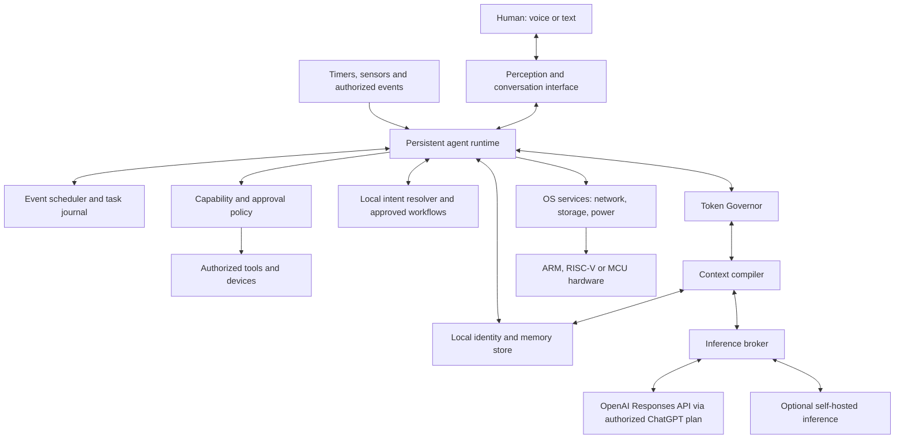

# AtomOS

**An OpenAI-native, always-on operating environment for personal AI agents, designed for minimal hardware, power and token consumption.**

AtomOS is an experimental project to build a persistent, conversational AI agent that can operate continuously on inexpensive, low-power hardware. The agent owns its identity, memory, permissions and scheduled activities independently of the language model it uses. Reasoning is delegated to OpenAI only when necessary, with the goal of operating within an owner's existing ChatGPT Plus subscription without additional AI spending. The runtime remains useful offline and retains a narrow inference interface for optional self-hosted models.

**Status:** Architecture and planning. No implementation or performance benchmarks yet.

## Design goals

- Run continuously on commodity ARM, RISC-V and, eventually, microcontroller-class hardware.
- Minimize idle power, RAM, storage, CPU wakeups and network traffic.
- Make voice and text conversation native interfaces, without requiring a desktop or screen.
- Preserve identity, conversation context, commitments and preferences across reboots and model changes.
- Make OpenAI the first-class remote inference provider, using official ChatGPT plan sharing where eligible and authorized. Keep agent state and local operation independent of the provider.
- Treat inference as a finite system resource: resolve routine events locally, compile minimal context and enforce token budgets before every remote request.
- Target zero incremental AI spending; never purchase credits or silently switch to a separately billed API.
- Keep routine scheduling, simple commands and local memory available without internet access.
- Enforce least privilege for tools, data and device access. Keep the owner in control of the agent and its data.
- Prefer simple, auditable components and reproducible, hardware-specific builds.

## Non-goals for the first release

- Training or hosting a general-purpose LLM on a microcontroller.
- Replacing Linux with a new kernel before the agent runtime is validated.
- Supporting arbitrary desktop applications, POSIX compatibility on microcontrollers or a graphical desktop.
- Unrestricted autonomous actions, continuous audio recording or mandatory remote storage.
- Unlimited remote inference, unofficial ChatGPT endpoints, browser automation for inference, or circumventing subscription limits.

## Architecture



The language model is a replaceable computational resource. The persistent agent runtime is responsible for state, context selection, task execution and authorization. Model output is treated as untrusted input, never as direct authority to execute a tool.

### Runtime lifecycle

| State | Activity |
| --- | --- |
| Resting | Wait for a wake word, timer, message or sensor event. |
| Perceiving | Capture speech or text and classify the event. |
| Responding | Retrieve relevant context and perform local or delegated conversation. |
| Reasoning | Invoke an appropriate model only when necessary. |
| Consolidating | Checkpoint state, summarize selected interactions and maintain memory within quotas. |

Use an event-driven architecture with bounded queues, explicit timeouts, retry backoff and no mandatory continuous inference loop. Keep task checkpoints durable, and make retried operations idempotent wherever possible.

## OpenAI-native inference and token economics

### Subscription-only operating policy

Use the official [Sign in with ChatGPT developer documentation](https://developers.openai.com/siwc/token-sharing-open-source) for eligible locally hosted integrations. The first integration must verify AtomOS eligibility, supported capabilities and the user's consent before enabling live inference. A private development repository does not itself establish eligibility.

- Use the documented OAuth registration and authorization flow, PKCE, validated identity and granted `chatgpt.tokens.use.direct` permission. Persist the issued client registration and a stable, opaque host identifier; protect and revoke credentials according to the provider's guidance.
- Discover available models through supported endpoints. Use authorized streaming Responses API requests with `store: false` and `stream: true` as required; keep durable conversation state locally. Do not assume this setting guarantees zero provider retention.
- No API-key billing fallback, credit purchases, unofficial endpoints or automatic plan upgrades. The owner must disable additional credit use for the app in ChatGPT's controls; confirm this prerequisite and fail closed if subscription-only spending cannot be established. An internal token cap alone cannot enforce the provider's billing rules.
- Treat provider usage limits and eligibility as authoritative. On a subscription usage limit, pause remote inference and direct the owner to ChatGPT usage settings. Do not infer a reset time, rotate accounts or retry around the restriction. Use bounded backoff only for transient failures.
- Plus allowances are shared, variable and not a guaranteed monthly raw-token quota. Account-level usage outside AtomOS may reduce available capacity. The agent does not inherit access to existing ChatGPT conversations or memories.

Reference: [OpenAI recovery guidance](https://developers.openai.com/siwc/token-sharing-open-source/errors-and-recovery) and [ChatGPT plan sharing controls](https://help.openai.com/en/articles/20001542-using-your-chatgpt-plan-in-other-apps-and-sites).

### Token Governor

The Token Governor is a mandatory runtime service, not a model prompt. All remote inference, including tool follow-ups, retries, memory consolidation and background work, must pass through a single admission interface.

1. Attempt safe deterministic intent resolution, structured memory lookup and authorized workflow execution locally.
2. Assign a priority and the lowest sufficient model/reasoning effort without an extra model call.
3. Compile only relevant instructions, recent context, selected memories and necessary tool schemas. Preserve authorization and safety-critical context; expand context when accuracy requires it.
4. Estimate and reserve input and maximum output usage before dispatch. Enforce rolling and monthly local quotas, concurrency limits and per-task call/deadline limits.
5. Stream the response, reconcile reported usage with the reservation and persist a durable ledger. Count reasoning tokens as part of output where reported, not twice. Track cached tokens separately; do not assume subscription discounts.
6. Preserve interactive capacity by deferring low-priority work. Stop remote calls when budgets, provider limits or authorization prohibit them. Continue local operations and explain degraded capabilities.

Use compact typed memory, local indexing, bounded context windows, stable prompt prefixes where beneficial, and validated reusable workflows. No mandatory remote embeddings, vector database, local LLM or idle inference. Never truncate essential context merely to meet a token target; request permission for a larger task or defer it. Cache only appropriate responses with scope, freshness and invalidation controls.

| Intelligence level | Execution |
| --- | --- |
| L0 — Reflex | Local timers, sensors, simple commands and facts; zero remote tokens. |
| L1 — Procedure | Local, previously authorized workflows; zero remote tokens. |
| L2 — Conversation | Efficient available OpenAI model, minimal sufficient context and reasoning. |
| L3 — Analysis | Increased context or reasoning within the task budget. |
| L4 — Deep reasoning | Explicitly prioritized complex tasks, bounded by available allowance and policy. |

### Initial inference budgets

| Metric | Engineering target / policy |
| --- | --- |
| Incremental AI spending | $0 above existing subscription; hard policy subject to verified provider controls. |
| Idle remote inference | 0 calls and tokens. |
| Routine events handled locally | At least 75% on a defined representative workload; unrestricted conversation measured separately. |
| Routine remote request | At most 1,500 raw input + output tokens, including reasoning. |
| AtomOS monthly raw-token target | 750,000, configurable downward as needed. |
| Default input / output budget | 1,024 / 256 tokens; output includes reasoning where applicable. |
| Background allocation | At most 10% of local monthly budget. |
| Interactive reserve | 30% of local monthly budget protected from noninteractive work. |
| Mandatory remote embeddings / local LLM | None. |

These are internal design targets, not ChatGPT Plus entitlements. For example, 100 events/day with 75% resolved locally and 900 total tokens per remote call yields 675,000 raw tokens over 30 days, before any additional calls. Measure actual usage and quality with a representative workload including tool loops and memory maintenance. Do not claim a month fits Plus until tested against real account limits.

### Voice pipeline

Keep wake-word detection and voice activity detection local. Capture speech only after activation, perform STT locally or on an optional owner-operated server, route the resulting text through the local intent resolver and Token Governor, and synthesize speech locally where practical. No continuous cloud audio stream. Do not assume standalone OpenAI audio or Realtime endpoints are covered by plan sharing; disable them under subscription-only policy unless eligibility and zero incremental cost are verified. Benchmark unrestricted speech recognition separately from the text runtime.

## Memory and identity

| Memory class | Purpose |
| --- | --- |
| Identity | Stable agent ID, owner configuration, personality and instructions. |
| Working | Current conversation and active task context. |
| Episodic | Selected interactions, events and their provenance. |
| Semantic | User-approved facts, relationships and preferences. |
| Procedural | Tool descriptions, approved procedures and workflows. |
| Prospective | Reminders, commitments and scheduled tasks. |

Use a bounded local store with a journal, compact serialization, indexed retrieval and configurable retention. Start with SQLite on Linux; evaluate a flash-friendly journal and CBOR on embedded targets. Preserve timestamps and provenance. Distinguish owner-provided instructions from model-generated summaries and retrieved content. Provide export, correction and deletion of persistent memories, and never store raw audio by default.

Each agent has a stable identifier and cryptographic credentials. Device enrollment, key rotation, recovery and revocation must be designed before cross-device identity synchronization is enabled. Private keys must never be sent to an inference provider.

## Technical approach

| Component | Initial choice |
| --- | --- |
| Agent runtime | Rust, with a small dependency footprint |
| OS foundation | Buildroot minimal Linux for the first prototype |
| Event processing | Bounded asynchronous Rust tasks |
| Persistent state | SQLite on Linux; compact journal on constrained targets |
| Serialization | CBOR internally where useful; JSON for provider APIs |
| Networking | HTTPS/TLS, streaming WebSocket where supported |
| Voice | Local wake-word detection and VAD; local/self-hosted STT/TTS first |
| Inference | OpenAI-first streaming Responses API adapter using eligible ChatGPT plan sharing; local rules and mock adapter as offline baseline |
| Inference policy | Rust Token Governor, durable usage ledger, local intent resolver and context compiler |
| Security | Capability-based tool authorization, Ed25519 device identity, vetted cryptography |
| Embedded evolution | Rust `no_std` where practical; existing ESP-IDF/RTOS components when justified |

Use Linux first to avoid spending the initial development cycle on hardware drivers. Consider ESP32 firmware or a dedicated kernel only after profiling shows where the OS foundation creates a measurable bottleneck. Keep platform-specific code behind narrow interfaces; do not assume Linux binaries or libraries can simply be recompiled for a microcontroller.

## Reference hardware and resource budgets

Initial platform: Raspberry Pi Zero 2 W (512 MB RAM), with an ESP32-S3 voice endpoint as the subsequent constrained-hardware target. A Milk-V Duo-class RISC-V board is a potential additional port.

| Metric | Core target (Linux SBC) | Micro target (ESP32-S3 with PSRAM) |
| --- | --- | --- |
| Complete device cost | Under $35 | Under $20 |
| Idle power at device input | Under 1 W | 0.1–0.5 W |
| Total OS + runtime active RAM | 64 MB or less | 1–4 MB target |
| OS + runtime storage image | 128 MB or less | 4–16 MB target |
| Persistent memory budget | 256 MB initially | Hardware-dependent; external storage optional |
| Operation | 24/7 | 24/7 |
| General-purpose model inference | Remote or separate local server | Remote or separate local server |

These are **unvalidated engineering targets**, not existing capabilities or retail quotes. Complete device cost includes board, power, storage and audio hardware as applicable. Micro targets depend on flash/PSRAM configuration, networking and audio buffers. Power targets exclude the separate inference server; report both endpoint and end-to-end energy in benchmarks. Measure idle and active states separately, with Wi-Fi and voice configuration documented.

## Security and privacy

- Default-deny capabilities for filesystem, network, devices, tools and secrets.
- Require explicit confirmation for sensitive, irreversible or externally visible actions according to owner-configured policy.
- Treat model output, external content and tool results as untrusted; validate tool calls against typed schemas and authorization rules.
- Use secure transport, credential isolation, signed updates and encrypted storage where supported by the threat model and hardware.
- Support physical microphone mute where possible and clear indicators when capturing or transmitting audio.
- Maintain bounded audit logs of tool calls, policy decisions and task outcomes; redact credentials and sensitive payloads.
- Apply resource quotas, rate limits, cancellation, deadlines and recovery procedures to agent workloads. Prevent tools, extensions and background jobs from bypassing inference admission or accessing provider credentials.
- Provide a local owner-controlled shutdown and safe mode. Fail closed on authorization errors.

## Development roadmap

| Milestone | Deliverable / exit criteria |
| --- | --- |
| M0 — Design | README, architecture decisions, threat model, resource and inference budgets, and reference hardware selection. |
| M1 — Agent core | Rust CLI, stable local identity, persistent journal, local intent resolver, Token Governor, usage ledger, mock inference and initial official OpenAI authentication/eligibility validation. Restart restores state and budget. |
| M2 — Model broker | Authorized OpenAI subscription-only streaming text inference, context compiler, model discovery and quota/error handling. Verify no paid fallback; optional self-hosted adapter only after core path is validated. |
| M3 — Memory and scheduling | Bounded local retrieval, memory editing/export, durable reminders, approved workflow reuse, cancellation and restart recovery; budgeted consolidation. |
| M4 — Minimal OS | Bootable Buildroot image for Pi Zero 2 W, automatic service startup, health checks and measured resource budgets. |
| M5 — Voice | Local wake word and VAD, local/self-hosted STT/TTS, interruption and mute control; measure audio footprint and verify subscription-only operation. |
| M6 — Tools and security | Typed tool calls, policy enforcement, approval flow, audit logging and adversarial tests before broad tool access. |
| M7 — Embedded port | Evaluate ESP32-S3 implementation, power management, storage durability and audio performance. |
| M8 — Distributed agent | Optional authorized node discovery, encrypted synchronization, conflict resolution and inference routing. Evaluate Nostr as an optional transport. |
| M9 — OS specialization | Compare optimized Linux, RTOS and custom kernel approaches using equivalent workloads. Proceed only with demonstrated benefits. |

Security requirements apply from M1; M6 expands and verifies the tool execution surface rather than deferring basic security until then.

### First prototype acceptance criteria

1. Boot and start automatically on the reference board without a desktop environment.
2. Accept text input, resolve supported routine intents locally and stream an eligible OpenAI response through the Token Governor when inference is necessary; verify subscription-only controls before live use.
3. Preserve agent identity, conversation history and pending reminders after a controlled restart.
4. Continue local scheduling and safe commands when the inference provider is unreachable.
5. Recover from provider errors without an unbounded retry loop or duplicate side effects.
6. Measure image size, peak and idle RAM, CPU utilization, power, boot time and response latency. Document hardware and test conditions.
7. Verify zero remote inference while idle and no remote calls for deterministic test cases. Measure local resolution rate, total tokens per task, response quality and quota consumption on a reproducible workload.
8. Test budget exhaustion, concurrent reservations, restart recovery, denied scopes, unavailable allowance and provider quota limits. Demonstrate offline continuation, no paid fallback and no bypass of the Token Governor.

Voice is an explicit subsequent milestone. The first prototype validates the agent architecture before introducing audio complexity.

## Proposed repository layout

```text
atomos/
  README.md
  docs/             # Architecture, ADRs, threat model, resource and inference budgets
  crates/           # Runtime, memory, policy, inference, governor, platform interfaces
  apps/             # CLI and later voice endpoint
  platform/         # Buildroot and embedded board definitions
  tests/            # Integration, recovery, security tests
  benchmarks/       # RAM, power, latency, durability, tokens and task quality
```

Only the README is intended for the initial commit. The remaining structure will be created as implementation begins.

## Prior art to evaluate

- [MimiClaw](https://github.com/memovai/mimiclaw): microcontroller agent runtime.
- [XiaoZhi](https://github.com/78/xiaozhi-esp32): ESP32 conversational voice endpoint.
- [ZeroClaw](https://github.com/zeroclaw-labs/zeroclaw): Rust agent runtime.
- [NullClaw](https://github.com/nullclaw/nullclaw): small Zig agent runtime.
- [Letta](https://github.com/letta-ai/letta): stateful agent and memory architecture.
- [AIOS](https://github.com/agiresearch/AIOS): OS-level abstractions for agents.
- [Tock](https://github.com/tock/tock): embedded kernel and isolation architecture.
- [Buildroot](https://buildroot.org/): minimal embedded Linux images.

These are research references, not selected dependencies. Verify current upstream status, licenses, security properties and performance claims before incorporating any code.

## Open decisions

- Exact reference board, microphone and speaker configuration.
- Validate AtomOS eligibility for OpenAI plan sharing, account-level spending controls, supported model capabilities and data retention policies. Define headless sign-in/enrollment using only documented flows.
- Establish real-world Plus usage headroom and benchmark token efficiency without compromising response quality.
- Memory retrieval strategy, flash wear management and encryption/key recovery.
- Runtime dependency choices and whether shared core code can remain portable to MCU targets.
- Distributed identity protocol and synchronization semantics.
- Project license and eventual public release. Apache-2.0 is a candidate; no license is granted by this planning document.
- Project name availability before a public release.

## Project principles

Own the agent and its memory. Use OpenAI intelligence deliberately, spend tokens only when they improve the result, and never incur additional AI costs automatically. Spend energy on useful work, preserve state across failure, and measure before optimizing.
