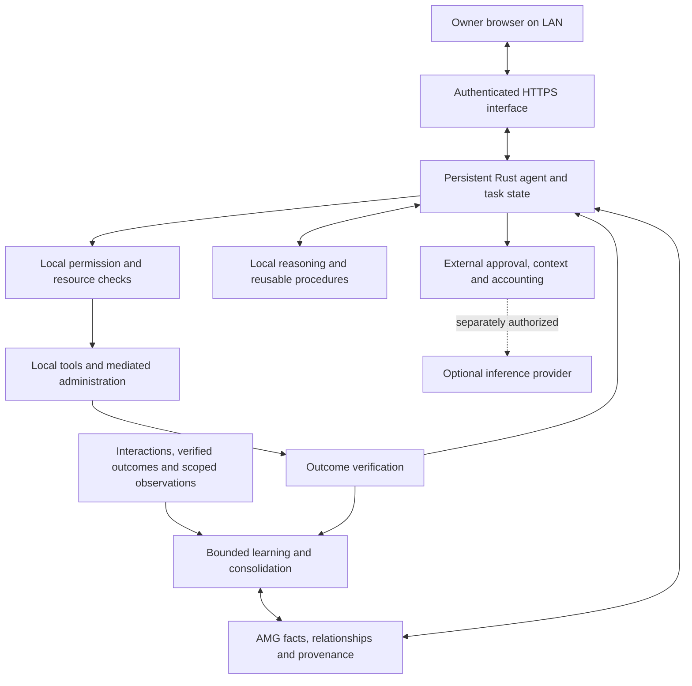

# AtomOS

**An always-running local agent with a LAN browser interface, persistent graph memory, broad control of its dedicated Linux device and optional external reasoning.**

AtomOS is being built to learn from owner interactions, verified task results and scoped system/network observations, using local resources efficiently and retaining useful knowledge with provenance. External effects require approval or an approved standing policy. Optional external inference must preserve zero incremental AI spending; there is no paid fallback.

**Owner-approved direction (2026-11-27):** LAN-only web interaction, continuous service operation, local agency and graph-based learning. Voice communication is removed from the product roadmap. Linux remains the foundation; the CLI remains for maintenance. [Active roadmap](docs/agent-roadmap.md) | [Design](docs/local-agent-direction.md).

**Implemented versus planned:** The installed runtime remains the verified local/mock CLI. The web service, autonomous executor, learning pipeline, packet observation, local model and production provider connection are not yet implemented. This source cleanup removes voice-only components; historical evidence below applies to the tested revisions it names.

**Status:** M1.1–M1.4f local runtime and AMG foundations merged and offline/scale-tested. M2.1–M2.3d synthetic broker/authorization, bounded replay, official owner-run OAuth, encrypted vault, model discovery and token refresh verified at their respective gates. M2.4's three live qualification attempts are consumed with unknown usage; the final attempt received 8,465 bytes and validated eight SSE events before an unsupported event. M2.4b–c isolated offline auxiliary-event, opaque reasoning and refusal profiles merged and tested. General live inference, integrated account-bound admission and private memory deployment remain unqualified; voice/custom-OS work is outside the active roadmap. M2.5a offline admission is implemented; its time/task follow-up is merged, and M2.5b extended decoder integration is implemented offline and merged in PR #36.

**M2.5b complete offline:** [PR #36](https://github.com/idmfrank/atomos/pull/36) merged typed extended outcomes and atomic settlement; [post-merge CI](https://github.com/idmfrank/atomos/actions/runs/46080072830) passed on `e3ebf24`. All 193 tests, Rust 1.75 core targets, 18,000 decoder samples, frozen-reference comparison and full 1K/10K/100K scale/recovery passed. [Exact commits, runs and limits](docs/m2-text-outcomes.md#verified-candidate-evidence). Ordinary conversation still uses the installed local/mock CLI; development continues directly here without a separate handoff.

**CLI session implementation:** [Session implementation and commands](docs/cli-session-contract.md) are implemented, merged in [PR #38](https://github.com/idmfrank/atomos/pull/38) and deployed in default local/mock session mode: local help/status/clear/quit, bounded local-only working turns, read-only memory and explicit synthetic outcome/accounting status. All 215 distinct tests, Rust 1.75 core targets, 18,000 decoder samples, session parity and full host/CI scale/recovery passed. [Exact evidence and footprint costs](docs/resource-budget.md#cli-session-verified-evidence). Legacy launch behavior is preserved. The installed release is now e7e8fc9; [verified deployment and launch](docs/linux-cli-deployment.md#deployed-session-release). No provider connection.

**Session handoff:** [PROJECT_STATE.md](PROJECT_STATE.md) records the current verified baseline, next steps and gates for ChatGPT and Codex.

**Linux deployment:** the PR #38 local/mock session CLI is built, installed and running under the selected owner account on the headless Linux reference host. [Setup, launch and evidence](docs/linux-cli-deployment.md). Current installed source e7e8fc9 passed post-merge CI; its runtime passed all 215 tests, 18,000 decoder samples and full host/CI scale/recovery. Installed hash/memory/session checks passed. Real provider conversation remains pending; previous release 5869e20 is retained.

**M2.5a:** opt-in [atomic account-bound synthetic admission](docs/m2-atomic-admission.md), immutable request identity and one durable admission/reservation record. Initial PR #30 was merged externally; [PR #31](https://github.com/idmfrank/atomos/pull/31) adds fresh admission time/active task checks and was also merged externally; PR #32 reconciled its evidence and is merged. The M2.3 two-journal reference remains available; the [M2.5b implementation contract](docs/m2-text-outcomes.md) merged in PR #34 and defines offline decoder outcomes, cancellation and atomic settlement for the CLI MVP; runtime implementation is verified offline and merged in PR #36. No live inference is authorized.

## Current implementation

| Slice | Implemented (automated tests passed) |
| --- | --- |
| M1.1 | Dependency-free Rust core/CLI, local/mock inference, turn epochs, bounded playback queue, fixed-budget persistent reservation ledger. [PR #2](https://github.com/idmfrank/atomos/pull/2) |
| M1.2 | Single-turn ALSA/Whisper.cpp/Piper smoke harness, transcript bounds, instance-scoped reservations, stub audio tests. [PR #3](https://github.com/idmfrank/atomos/pull/3) |
| M1.3 | Persistent Rust voice coordinator, streaming PCM protocol, RMS endpointing, follow-up window, AEC-gated cancellation, optional warm Sherpa-ONNX/Kokoro adapter, IPC startup/deadline fixes. [PR #4](https://github.com/idmfrank/atomos/pull/4) |
| M1.4a | Initial SQLite-backed typed memory, explicit owner CLI and regression tests merged; locked offline CI passed. See [AMG foundation](docs/m1-amg-foundation.md). |
| M1.4b | Opt-in read-only text and synthetic voice recall, persistent display name, bounded subject follow-up, live correction/deletion visibility. [PR #6](https://github.com/idmfrank/atomos/pull/6), [implementation](docs/m1-amg-conversation.md); locked offline CI passed. |
| M1.4c | Scoped graph/FTS retrieval, deterministic ranking, required facts, connector evidence and bounded data-only context previews. [Implementation](docs/m1-amg-context.md); locked offline CI passed. |
| M1.4d | Explicit expiring revision-specific voice grants, schema v2 migration, logical export/restore and integrity checks. [Implementation](docs/m1-amg-recovery.md); locked offline CI passed. |
| M1.4e | Active SQLite benchmark and alternative-engine qualification. [Implementation](docs/m1-amg-benchmark.md); scale CI passed after [PR #10](https://github.com/idmfrank/atomos/pull/10). |
| M1.4f | Compact-scope FTS optimization, reference verification, streaming logical backup and storage accounting. [Implementation](docs/m1-amg-optimization.md); CI and scale validation passed. |
| M2.1 | Offline inference broker, durable admission, typed synthetic response replay and usage reconciliation. [Implementation](docs/m2-inference-broker.md); locked offline CI passed. |
| M2.2 | Optional bounded Responses SSE/JSON decoder, strict text lifecycle, governor-gated byte replay and differential tests. [Implementation](docs/m2-responses-replay.md); CI and full scale validation passed. |
| M2.3 | Offline account-bound authorization policy, fixed-window request IDs, expiry, durable suspension and subscription error recovery. [Implementation](docs/m2-account-authorization.md); CI and full scale validation passed; live inference remains disabled. |
| M2.3b | Optional auth-only Sign in with ChatGPT utility, PKCE, signed identity and protected local session records. [Implementation](docs/m2-official-sign-in.md); CI passed; no inference. |
| M2.3c | Passphrase-encrypted credential vault, strict JSON, read-only model discovery, spending gate review and Node24 checkout pin. [Implementation](docs/m2-auth-hardening.md); CI passed; no inference. |
| M2.3d | Owner WSL OAuth registration, encrypted session reopen and account-specific catalog succeeded; [PR #17](https://github.com/idmfrank/atomos/pull/17), [PR #18](https://github.com/idmfrank/atomos/pull/18). 50% app cap observed; live refresh verified, revocation untested. |
| M2.4 | [Historical owner-run qualification](docs/m2-first-live-qualification.md), three consumed attempts; final bounded body received, no completed inference or actual usage validated. No fourth attempt. |
| M2.4b–c | [Offline protocol compatibility](docs/m2-protocol-compatibility.md): auxiliary events, optional opaque reasoning and typed refusal; PR #27–28 passed. Existing broker and live harness unchanged. |

Historical verified CI baseline: `c563599f2e2c8b5abb7e03c75bb85e67e831e75d` (PR #33 CLI roadmap), with unchanged runtime from PR #31. [Post-merge CI 46029012445](https://github.com/idmfrank/atomos/actions/runs/46029012445) passed, including the same 173 distinct tests, Rust 1.75 candidate core targets, decoder/admission/text benchmarks and 1K AMG smoke. The last GitHub full 1K/10K/100K scale run remains [46026109238](https://github.com/idmfrank/atomos/actions/runs/46026109238) on PR #32 `5bca8a15e8245e9631d8a978a988c01cdc812f7a`. PR #33 and the later PR #34 contract are documentation-only; PR #34 post-merge [CI 46055361823](https://github.com/idmfrank/atomos/actions/runs/46055361823) passed. Those runs predate M2.5b. Current merged evidence is linked above; original host measurements are recorded separately below.

Detailed CI benchmark tables below retain their PR #32 run provenance. New direct Linux-host measurements: release CLI 479,672 bytes; at 100K, exact/context p95 0.0793/0.3974 ms, active CLI peak RSS 4,500 KiB vs 3,052 without a store. SSD-backed admission p95 reference/candidate 5.150968/2.623407 ms with fsyncs 2/1 and exact accounting. [Complete host evidence](docs/resource-budget.md#verified-linux-cli-host-baseline). Default-temp tmpfs results are not disk-durability evidence; no controlled comparison with different CI toolchains is claimed.

### Benchmark results

**Release CLI history — text-only, no active store or ledger**

| Milestone | Executable (bytes) | Peak RSS (KiB) | Rust tests | Python tests |
| --- | ---: | ---: | ---: | ---: |
| M1.1 | 296,824 | 2,068 | 15 | 0 |
| M1.2 | 302,072 | 2,020 | 18 | 0 |
| M1.3 | 314,224 | 2,136 | 29 | 5 |
| M1.4a | 314,224 | 2,040 | 35 | 5 |
| M1.4b | 366,440 | 2,644 | 35 | 9 |
| M1.4c | 462,552 | 2,628 | 40 | 10 |
| M1.4d | 464,912 | 2,608 | 44 | 11 |
| M1.4e (schema v3) | 464,912 | 2,776 | 46 | 11 |
| M1.4f | 466,464 | 2,796 | 51 | 11 |
| M2.1 | 466,464 | 2,704 | 61 | 11 |
| M2.2 | 466,464 | 2,676 | 75 | 11 |
| M2.3a | 466,512 | 2,624 | 86 | 11 |
| M2.3b | 466,512 | 2,664 | 86 | 11 |
| M2.3c | 466,512 | 2,524 | 86 | 11 |
| M2.4 (PR #19, historical) | 466,512 | 2,588 (full-scale no-store baseline) | 86 | 11 |
| M2.4c (PR #28) | 466,512 | 2,576 (full-scale no-store baseline) | 96 | 11 |
| PR #29 (documentation reconciliation) | 466,512 | 2,588 (full-scale no-store baseline) | 96 | 11 |
| M2.5a follow-up 3895b2b (PR #31 head) | 466,512 | 2,580 (full-scale no-store baseline) | 119 | 11 |
| M2.5a main a91ccd9 | 466,512 | 2,612 (full-scale no-store baseline) | 119 | 11 |
| PR #32 main 5bca8a1 | 466,512 | 2,592 (full-scale no-store baseline) | 119 | 11 |

Each release CLI benchmark executes 1,000 local text interactions. Rust/Python test counts refer to the workspace suite, not benchmark samples. PR #28 passed 43 Node tests (150 distinct total); owner last reported 43/43 local Node tests at PR #25. Peak RSS is measured process memory; runner variation can affect comparisons. M2.1's broker is a separate synthetic replay example, not linked into the measured conversational CLI. Excludes OS, speech engines, Python adapter, active AMG, ledger and administration executable. See [resource budget and run links](docs/resource-budget.md).

| Last full scale (PR #32), p95 unless stated | 1K | 10K | 100K |
| --- | ---: | ---: | ---: |
| Exact recall (ms) | 0.0451 | 0.0537 | 0.0718 |
| Graph traversal (ms) | 0.1278 | 0.1349 | 0.1571 |
| Selective context (ms) | 0.2046 | 0.2646 | 0.3143 |
| Common-term context (ms) | 0.2485 | 0.5868 | 2.5666 |
| Reference common term (ms) | 0.4300 | 3.6474 | 38.7607 |
| Remember (ms) | 1.0803 | 1.1938 | 1.1384 |
| Correct (ms) | 1.2045 | 1.1371 | 1.2407 |
| Forget (ms) | 1.0261 | 1.0151 | 1.2006 |
| Active CLI peak RSS (KiB) | 4,232 | 4,100 | 4,232 |
| Restore (seconds) | 0.1180 | 1.3282 | 14.1180 |
| Recovery peak RSS (KiB) | 7,444 | 9,124 | 9,192 |

Same-run no-store RSS 2,592 KiB; 100K incremental 1,640 KiB. All sizes: 300/300 expected facts, 100 complete packets, precision/recall 1, 0/30 parity mismatches, zero recovery verification errors and remote calls. Main/restore DB bytes 1,216,512 / 11,186,176 / 116,084,736. Ranked context bytes per 100 requests 38,842 / 39,400 / 40,012 versus same-scope 90,072 / 91,000 / 92,020; bytes are not tokens.

| Historical admission benchmark (PR #32) | Reference | Candidate |
| --- | ---: | ---: |
| Admission p50 / p95 / p99 (ms), 300 samples | 0.338799 / 0.402973 / 0.492505 | 0.170752 / 0.216750 / 0.350707 |
| Completion p50 / p95 / p99 (ms) | 0.701052 / 0.820529 / 3.705018 | 0.367051 / 0.454600 / 0.859276 |
| Restart p50 / p95 / p99 (ms), 30 samples | 0.360311 / 0.395412 / 0.488649 | 0.240815 / 0.259973 / 0.447549 |
| Admission write syscalls / fsyncs | 4 / 2 | 2 / 1 |
| Process peak RSS (KiB) | 2,236 | 2,200 |
| Release harness (bytes) | 416,520 | 440,144 |
| Journal bytes per completed request | 52.560 | 104.280 |
| Final charge / errors | 14,100 / 0 | 14,100 / 0 |

Candidate background charge 7,050; validation p50/p95/p99 0.101/0.150/0.301 microseconds; compilation 0.391/0.691/1.072 microseconds. Candidate 600 append records/syncs include admission and settlement. Each process asserts independent expected charges; direct answer/usage parity is additionally covered by integration tests. Larger candidate journal and harness are explicit tradeoffs.

| Decoder profile, PR #32 CI | p95 1-byte (microseconds) | p95 64-byte | p95 4096-byte |
| --- | ---: | ---: | ---: |
| Strict reference | 27.6 | 19.7 | 19.8 |
| Compatibility, same wire | 28.9 | 19.8 | 19.8 |
| Auxiliary events | 33.5 | 23.0 | 24.0 |
| Extended, same wire | 27.6 | 19.3 | 19.3 |
| Opaque reasoning | 35.3 | 24.1 | 24.0 |
| Refusal | 27.0 | 19.6 | 18.1 |

1,000 samples per profile/read size; 18,000 synthetic replays, zero errors/provider calls. Combined process peak RSS 2,180 KiB. Compare same-wire profiles for overhead; expanded fixtures are different inputs.

These are synthetic hosted process measurements, not whole-system RAM, device energy, provider billing, actual token savings or general answer-quality results. Timings vary across runners; no controlled cross-run performance claim. Earlier verified measurements are retained in [PROJECT_STATE](PROJECT_STATE.md) and [atomic admission](docs/m2-atomic-admission.md).

### Development quick start

For a prepared Linux host, use the [owner-local deployment procedure](docs/linux-cli-deployment.md). It separates build/test dependencies from the running CLI, uses a versioned tested release and private identity store, and requires disk-backed TMPDIR for storage benchmarks. Existing generic commands below remain valid. No desktop, speech stack or local model is needed.

Linux, Rust/Cargo (declared minimum 1.75, CI previously verified on 1.100), Bash, Python 3, GNU coreutils, pkg-config and SQLite development library with FTS5. M1.4a requires explicitly provisioned, locked Cargo dependencies. Candidate atomos-core all-target tests pass on Rust 1.75; whole-workspace minimum-version compatibility remains unverified because an existing getrandom dependency requires edition-2024 Cargo. Default workspace CI uses the installed newer toolchain:

```bash
cargo fetch --locked # explicit provisioning step
bash scripts/test.sh
cargo run --locked --offline -p atomos-cli --bin atomos
bash scripts/benchmark.sh
```

Try "what is your name?" (local), "explain entropy" (mock), and "/quit". Earlier voice experiments are historical and their runtime/adapters have been removed from the current source. Executable changes require passing CI before merge.

## Design goals

- Keep the agent continuously available on the existing Linux device, independent of browser connections.
- Provide authenticated, encrypted browser interaction restricted to the local network.
- Execute and verify local tasks with standing device authority and recoverable administration.
- Learn useful facts and procedures from interactions, outcomes and scoped observations; preserve provenance, uncertainty and owner correction/deletion.
- Use bounded queues, rotating evidence, disk reserves and resource limits; owner-reported 2 TB disk capacity requires verification before numeric quotas.
- Combine deterministic local work, useful benchmark-selected local inference and optional approved external reasoning.
- Require approval or a bounded standing policy for external effects and disclosures; no paid inference fallback.

## Non-goals

Voice communication, a custom kernel, public internet hosting, multi-user service, unbounded packet retention, automatic model weight training and unapproved external actions are outside this roadmap.

## Architecture



This is target architecture, not implemented wiring. Closing a browser does not cancel a task. Restart must reconcile interrupted actions before any retry. Network and privilege enforcement must cover subprocesses; the model cannot expand its own permissions. [Architecture](docs/architecture.md), [security](docs/threat-model.md), [learning/storage contract](docs/agent-roadmap.md#observation-and-storage-contract).

## OpenAI-native inference and token economics

### Subscription-only operating policy

Use the official [Sign in with ChatGPT developer documentation](https://developers.openai.com/siwc/token-sharing-open-source) for eligible locally hosted integrations. The first integration must verify AtomOS eligibility, supported capabilities and the user's consent before enabling live inference. A private development repository does not itself establish eligibility.

- Use the documented OAuth registration and authorization flow, PKCE, validated identity and granted `chatgpt.tokens.use.direct` permission. Persist the issued client registration and a stable, opaque host identifier; protect and revoke credentials according to the provider's guidance.
- Discover available models through supported endpoints. Use authorized streaming Responses API requests with `store: false` and `stream: true` as required; keep durable conversation state locally. Do not assume this setting guarantees zero provider retention.
- No API-key billing fallback, credit purchases, unofficial endpoints or automatic plan upgrades. The owner must disable additional credit use for the app in ChatGPT's controls; confirm this prerequisite and fail closed if subscription-only spending cannot be established. An internal token cap alone cannot enforce the provider's billing rules.
- Treat provider usage limits and eligibility as authoritative. On a subscription usage limit, pause remote inference and direct the owner to ChatGPT usage settings. Do not infer a reset time, rotate accounts or retry around the restriction. Use bounded backoff only for transient failures.
- Plus allowances are shared, variable and not a guaranteed monthly raw-token quota. Account-level usage outside AtomOS may reduce available capacity. The agent does not inherit access to existing ChatGPT conversations or memories.

Reference: [OpenAI recovery guidance](https://developers.openai.com/siwc/token-sharing-open-source/errors-and-recovery) and [ChatGPT plan sharing controls](https://help.openai.com/en/articles/20001542-using-your-chatgpt-plan-in-other-apps-and-sites).

### Token Governor

The Token Governor is a mandatory runtime service, not a model prompt. All remote inference, including tool follow-ups, retries, memory consolidation and background work, must pass through a single admission interface.

1. Attempt safe deterministic intent resolution, structured memory lookup and authorized workflow execution locally.
2. Assign a priority and the lowest sufficient model/reasoning effort without an extra model call.
3. Compile only relevant instructions, recent context, selected memories and necessary tool schemas. Preserve authorization and safety-critical context; expand context when accuracy requires it.
4. Estimate and reserve input and maximum output usage before dispatch. Enforce rolling and monthly local quotas, concurrency limits and per-task call/deadline limits.
5. Stream the response, reconcile reported usage with the reservation and persist a durable ledger. Count reasoning tokens as part of output where reported, not twice. Track cached tokens separately; do not assume subscription discounts.
6. Preserve interactive capacity by deferring low-priority work. Stop remote calls when budgets, provider limits or authorization prohibit them. Continue local operations and explain degraded capabilities.

Use compact typed memory, local indexing, bounded context windows, stable prompt prefixes where beneficial, and validated reusable workflows. No mandatory remote embeddings, vector database, local LLM or idle inference. Never truncate essential context merely to meet a token target; request permission for a larger task or defer it. Cache only appropriate responses with scope, freshness and invalidation controls.

| Intelligence level | Execution |
| --- | --- |
| L0 — Reflex | Local timers, sensors, simple commands and facts; zero remote tokens. |
| L1 — Procedure | Local, previously authorized workflows; zero remote tokens. |
| L2 — Conversation | Efficient available OpenAI model, minimal sufficient context and reasoning. |
| L3 — Analysis | Increased context or reasoning within the task budget. |
| L4 — Deep reasoning | Explicitly prioritized complex tasks, bounded by available allowance and policy. |

### Initial inference budgets

| Metric | Engineering target / policy |
| --- | --- |
| Incremental AI spending | $0 above existing subscription; hard policy subject to verified provider controls. |
| Idle remote inference | 0 calls and tokens. |
| Routine events handled locally | At least 75% on a defined representative workload; unrestricted conversation measured separately. |
| Routine remote request | At most 1,500 raw input + output tokens, including reasoning. |
| AtomOS monthly raw-token target | 750,000, configurable downward as needed. |
| Default input / output budget | 1,024 / 256 tokens; output includes reasoning where applicable. |
| Background allocation | At most 10% of local monthly budget. |
| Interactive reserve | 30% of local monthly budget protected from noninteractive work. |
| Mandatory remote embeddings / local LLM | None. |

These are internal design targets, not ChatGPT Plus entitlements. For example, 100 events/day with 75% resolved locally and 900 total tokens per remote call yields 675,000 raw tokens over 30 days, before any additional calls. Measure actual usage and quality with a representative workload including tool loops and memory maintenance. Do not claim a month fits Plus until tested against real account limits.

### Voice removed

Voice communication, speech engines and audio hardware are removed from the product roadmap. Earlier voice milestone documents are historical; Git retains deleted implementations.

## AtomOS Memory Graph (AMG) and identity

**Decision for M2:** temporal property graph with provenance, backed by SQLite + FTS5 on Linux. Logical model independent of physical storage through typed Rust interfaces. Indexed relationships and durable revision history; no separate database daemon, mandatory vector database or remote embeddings. Retain SQLite based on measured workload requirements; equivalent redb and CozoDB adapters are deferred, not benchmarked. See [AMG architecture](docs/amg-architecture.md).

| Memory class | Purpose |
| --- | --- |
| Identity | Stable agent ID, owner configuration, personality and instructions. |
| Working | Current conversation and active task context. |
| Episodic | Selected interactions, events and their provenance. |
| Semantic | User-approved facts, relationships and preferences. |
| Procedural | Tool descriptions, approved procedures and workflows. |
| Prospective | Reminders, commitments and scheduled tasks. |

Use typed entities, directed edges and assertions with source, trust, valid and recorded times. Exact lookup first, bounded traversal, FTS5, local ranking; optional local embeddings only after measured benefit. Compile minimal sufficient context including conflicts, provenance and policy before governor admission. Working context stays in bounded RAM. Support explicit memory operations, scoped retrieval, correction/supersession, export and deletion including derived indexes/caches. No raw audio, ASR partials or credentials in memory. Evaluate compact flash journal/CBOR on constrained targets.

Initial unmeasured targets: <8 MiB incremental memory overhead, 256 MiB aggregate data quota, warm p95 exact lookup <5 ms, traversal <20 ms, context compilation <50 ms, depth 2 default/3 maximum, zero remote retrieval tokens. Existing governor journal remains independent. SQLite is not itself encryption; owner access, encrypted storage/key recovery, retention and backup/deletion policies must be addressed before real private data.

M1.4a implements a stable local agent ID, owner scope and display name; M1.4b retrieves the name during conversation. Persistent identity is not authentication. Personality configuration, cryptographic credentials and device enrollment remain planned. Device enrollment, key rotation, recovery and revocation must be designed before cross-device identity synchronization is enabled. Private keys must never be sent to an inference provider.

### Current conversational memory behavior

The conversational CLI is read-only today. Explicit mutations remain in the separate `atomos-memory` administration CLI; a unified owner command surface is planned, not implemented. The current implementation persists approved identity and explicit facts; automatic learning and derived-memory retention are planned under the agent roadmap.

Opt in with `atomos --memory DIR OWNER` (also before `--single-turn`). The existing database must be initialized by `atomos-memory`. The runtime uses a read-only SQLite connection and typed MemoryReader. Supported English grammar includes "what is your name?", "what is my favorite color?", "recall project status", and "and count" (previous subject). Exact values are re-read on each turn; only the subject key is retained in RAM. Clear it on unrelated or failed requests and session resets; working follow-up state is not durable. Missing facts or storage errors produce local status. Other open-ended questions still use mock reasoning. No model calls or automatic learning in the current implementation.

Voice recall has been removed. Text administration assumes a trusted OS operator. See [M1.4b](docs/m1-amg-conversation.md) for commands and tests. M1.4c adds explicit text-only scoped previews (`context SUBJECT QUESTION`), deterministic graph/FTS ranking and a conservative byte-bounded data packet. No automatic model routing. Scoped context compilation and active-store benchmarks are implemented; full policy-aware provider integration and authenticated private-memory controls remain pending; see [M1.4c](docs/m1-amg-context.md).

## Technical approach

| Component | Initial choice |
| --- | --- |
| Agent runtime | Rust, with a small dependency footprint |
| OS foundation | Existing Linux host; persistent service and LAN browser interaction planned |
| Event processing | Bounded asynchronous Rust tasks |
| Persistent state | AMG temporal property graph, SQLite + FTS5 for M2; compact journal on constrained targets planned |
| Serialization | CBOR internally where useful; JSON for provider APIs |
| Networking | HTTPS/TLS, streaming WebSocket where supported |
| Inference | OpenAI-first streaming Responses API adapter using eligible ChatGPT plan sharing; local rules and mock adapter as offline baseline |
| Inference policy | Local resolver, bounded AMG context compiler and offline broker with durable admission implemented; calendar/rolling budgets and authenticated provider permits planned |
| Security | Capability-based tool authorization, Ed25519 device identity, vetted cryptography |

Use Linux first to avoid spending the initial development cycle on hardware drivers. A custom kernel, embedded ports and satellites are outside the active roadmap.

## Reference hardware and resource budgets

Use the existing dedicated Linux device. Previously verified hardware: i7-6700, 16 GB RAM and SSD-backed storage. The owner reports 2 TB disk capacity; available capacity and filesystem layout require fresh verification. No hardware purchase is required by this roadmap.

Measure idle/active service footprint, browser request latency, executor overhead, ingestion throughput/drops, graph growth, storage rotation/deletion and representative local-model task quality. Reserve resources for SSH, OS maintenance and recovery. Existing retrieval benchmarks are not measurements of local model intelligence, agent success or whole-device power. [Resource evidence and pending measurements](docs/resource-budget.md).

## Security and privacy

- Default-deny capabilities for filesystem, network, devices, tools and secrets.
- Require explicit confirmation for sensitive, irreversible or externally visible actions according to owner-configured policy.
- Treat model output, external content and tool results as untrusted; validate tool calls against typed schemas and authorization rules.
- Use secure transport, credential isolation, signed updates and encrypted storage where supported by the threat model and hardware.
- Maintain bounded audit logs of tool calls, policy decisions and task outcomes; redact credentials and sensitive payloads.
- Apply resource quotas, rate limits, cancellation, deadlines and recovery procedures to agent workloads. Prevent tools, extensions and background jobs from bypassing inference admission or accessing provider credentials.
- Provide a local owner-controlled shutdown and safe mode. Fail closed on authorization errors.

## Development roadmap

[The active agent roadmap](docs/agent-roadmap.md) replaces the earlier CLI/voice sequence:

1. Remove unused voice code and reconcile documentation; validate retained behavior.
2. Define durable tasks and continuous-service lifecycle, including cancellation and crash reconciliation.
3. Build the authenticated LAN browser interface and service operation.
4. Add verified local execution and administrative authority with external-effect enforcement.
5. Add continuous learning into AMG from interactions/outcomes, then scoped host/network observations with retention controls.
6. Benchmark and integrate useful local reasoning; complete optional external augmentation under approved policy.
7. Validate sustained operation, task outcomes, reboot recovery, learning/deletion, resource limits and owner control.

Voice is not a later stage. Historical completed milestones retain their original evidence; all new agent/service acceptance results remain pending.

### First MVP acceptance criteria

The owner can use a LAN browser to submit and follow a local task, reconnect without duplicate execution, cancel work, inspect learned facts and their sources, correct/forget them, and see why an external action needs approval. The agent remains available after browser closure and recovers safely after restart. Demonstrate verified local task outcomes, bounded background learning/storage, protected SSH access and rejection of unauthorized egress. Label mock and unqualified reasoning honestly. See [the roadmap](docs/agent-roadmap.md).

## Repository layout and planned expansion

```text
atomos/
  README.md
  docs/             # Architecture, AMG, threat model, budgets, prototype notes
  crates/atomos-core/ # Rust text/session, governor, admission and decoder
  crates/atomos-memory/ # AMG schema, typed storage, administration and read-only reader
  apps/atomos-cli/    # Text maintenance and offline replay CLI
  scripts/          # Offline tests, benchmarks and owner-run auth
  .github/workflows/ # CI
  # Planned: memory/inference/policy crates, platform/ and expanded benchmarks/
```

Design: [architecture](docs/architecture.md), [AMG architecture](docs/amg-architecture.md), [threat model](docs/threat-model.md), [resource budget](docs/resource-budget.md), [inference architecture](docs/inference-architecture.md). Implementation: [M1.1](docs/m1-prototype.md), [M1.2](docs/local-voice-spike.md), [M1.3](docs/persistent-conversation.md).

## Prior art to evaluate

- [MimiClaw](https://github.com/memovai/mimiclaw): microcontroller agent runtime.
- [ZeroClaw](https://github.com/zeroclaw-labs/zeroclaw): Rust agent runtime.
- [NullClaw](https://github.com/nullclaw/nullclaw): small Zig agent runtime.
- [Letta](https://github.com/letta-ai/letta): stateful agent and memory architecture.
- [AIOS](https://github.com/agiresearch/AIOS): OS-level abstractions for agents.
- [Tock](https://github.com/tock/tock): embedded kernel and isolation architecture.
- [Buildroot](https://buildroot.org/): minimal embedded Linux images.

These are research references, not selected dependencies. Verify current upstream status, licenses, security properties and performance claims before incorporating any code.

## Open decisions

- Verify current disk capacity/layout and benchmark local models on the existing host.
- Owner sign-in and model catalog verified; validate actual model profiles, secure production enrollment, programmatic spending enforcement where available and provider retention policies. Headless enrollment remains a design gate.
- Establish real-world Plus usage headroom and benchmark token efficiency without compromising response quality.
- AMG schema/bindings, FTS5 and query benchmarks, embedded engine comparison, retention, flash wear and encryption/key recovery.
- Bound observation capture/retention, graph consolidation and derived deletion; define persistence and administration isolation.
- CI checkout action Node.js deprecation and minimum Rust version verification.
- Runtime isolation, LAN certificate provisioning, web stack footprint and local-model selection after measurement.
- Distributed identity protocol and synchronization semantics.
- Project license and eventual public release. Apache-2.0 is a candidate; no license is granted by this planning document.
- Project name availability before a public release.

## Project principles

Own the agent and its memory. Use OpenAI intelligence deliberately, spend tokens only when they improve the result, and never incur additional AI costs automatically. Spend energy on useful work, preserve state across failure, and measure before optimizing.

### M1.4d: memory recovery and disclosure

Historical M1.4d: schema v2 required explicit migration of v1 stores; no auto-migration. Its voice demo recall required an explicit expiring grant for the exact current revision, in addition to existing voice limits. New/corrected/restored facts default to no voice disclosure; no provider disclosure. Export/restore uses bounded logical records (not SQL), preserves identity and history, and rebuilds search in a new directory. Backups remain plaintext; older snapshots may resurrect forgotten records. Synthetic data only. See [M1.4d](docs/m1-amg-recovery.md) for commands, limits and outstanding controls.

### M1.4e active memory benchmark

After provisioning dependencies, run `AMG_SAMPLES=100 bash scripts/benchmark-amg.sh 1000`. Manual scale workflow supports 1k/10k/100k synthetic entities. Reports reader/graph/context/durable write latency, correctness, context bytes, quiescent storage and same-binary CLI RSS. Retain SQLite for M2 development; alternative adapters deferred pending owner review, no cross-engine performance claim. See [protocol](docs/m1-amg-benchmark.md).

### AMG schema v3 scale correction

The first 1k active-store benchmark passed, but exposed a global orphan-source cleanup scan (forget p95 151.786 ms). Schema v3 indexes source/successor references and deletes only affected unreferenced sources transactionally. v1/v2 stores require explicit `atomos-memory DIR OWNER migrate` with runtime stopped and offline backup; v2 grants preserved. Restore initializes v3 with no grants. Benchmark stages now report progress and time out individually. See [benchmark investigation](docs/m1-amg-benchmark.md#scale-deletion-correction-schema-v3). Schema v3 scale validation passed; see benchmark results above.

### M1.4f optimization and verification

[Combined scale results](https://github.com/idmfrank/atomos/actions/runs/45804554627): 100k entities, 250k assertions, main DB 116,084,736 bytes; active CLI RSS 4,228 KiB vs no-store 2,600 KiB; selective context p95 0.375 ms; common-term p95 44.899 ms. Synthetic fixture precision/recall 100%; 56.5% byte reduction vs same-scope facts, not measured token savings. M1.4f adds compact row-ID range optimization, synthetic reference parity, streaming export/restore (256 MiB/1M rows, outside active store), and `atomos-memory DIR OWNER storage` accounting; hard aggregate quota remains unverified. See [specification](docs/m1-amg-optimization.md) and [engineering rules](AGENTS.md). CI and scale validation passed.

### Verified M1.4f and M2.1

[Combined scale validation](https://github.com/idmfrank/atomos/actions/runs/45807347862): 100k entities, 250k assertions, common-term p95 5.9669 ms vs 60.7457 ms reference (same run), zero mismatches across 90 comparisons, active CLI 4,152 KiB RSS vs 2,568 KiB without store, 466,464-byte executable. Streaming export 600,005 records / 85,222,570 bytes, restore 18.20 s, recovery peak RSS 9,156 KiB; all integrity checks passed. Synthetic corpus only; no token savings or device certification. M2.1 merged and passed locked offline CI with a separate broker example and synthetic usage ledger; current conversation and AMG remain offline, no credentials or HTTP. See [M2.1](docs/m2-inference-broker.md).

### M2.2 offline Responses replay

After locked provisioning, `bash scripts/test-responses.sh` exercises the optional `responses-replay` feature (pinned serde/serde_json), compares wire and typed broker behavior and benchmarks the decoder. No default CLI networking or JSON dependency, credentials, real provider calls or private AMG disclosure. Narrow single-message text profile; unsupported event types fail closed. See [M2.2](docs/m2-responses-replay.md). Feature-enabled CI and full scale validation passed; see benchmark results above.

### M2.3 authorization and authentication

[Account authorization](docs/m2-account-authorization.md): fixed synthetic grant/window, durable single-use request IDs, expiry, account/host binding and persistent suspension. [Official sign-in](docs/m2-official-sign-in.md) and [auth hardening](docs/m2-auth-hardening.md) add optional Node cold-path OAuth, encrypted session vault, strict JSON, read-only catalog and explicit refresh. Actual owner-run sign-in, catalog and refresh succeeded. Programmatic spending verification, provider output ceiling, secure integrated credential handoff, revocation, trusted time and production admission remain open. No automatic renewal or paid fallback.

### M2.4 qualification and offline compatibility

[Historical owner-run procedure](docs/m2-first-live-qualification.md): all three one-shot attempts consumed, 3,072 retained local planning units; actual usage unknown. Final bounded stream received, eight events validated, then unsupported event. No successful terminal or expected output validated. No fourth attempt, no reset or re-registration. [Protocol compatibility](docs/m2-protocol-compatibility.md) records PR #27 and #28 verified isolated offline profiles; unknown events, tools and raw/streamed reasoning remain denied. SDK execution and live model profile remain unqualified.

## Documentation and contribution

[AGENTS.md](AGENTS.md) requires documentation review and updates with **every commit**, not just milestones. [PROJECT_STATE.md](PROJECT_STATE.md) is the canonical current handoff with test evidence, pending gates and next objective. Current architecture: [system](docs/architecture.md), [AMG](docs/amg-architecture.md), [inference](docs/inference-architecture.md), [threat model](docs/threat-model.md), [resource budget](docs/resource-budget.md). Earlier milestone files retain historical scope and measurements; use current guidance for operations. Review and reconcile verified CI/benchmarks after merge, never represent pending work as passed.
