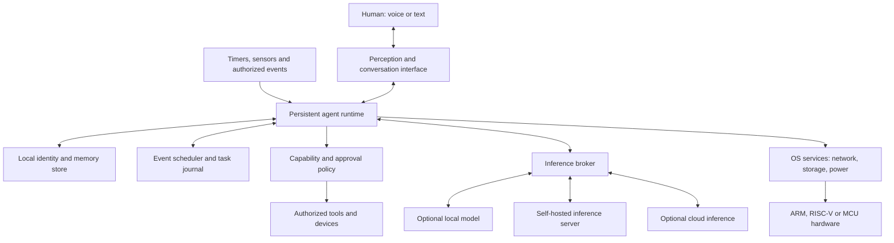

# AtomOS

**A lightweight, always-on operating environment for personal AI agents.**

AtomOS is an experimental project to build a persistent, conversational AI agent that can operate continuously on inexpensive, low-power hardware. The agent owns its identity, memory, permissions and scheduled activities independently of the language model it uses. Reasoning can be delegated to a local server or a remote inference provider when needed.

**Status:** Architecture and planning. No implementation or performance benchmarks yet.

## Design goals

- Run continuously on commodity ARM, RISC-V and, eventually, microcontroller-class hardware.
- Minimize idle power, RAM, storage, CPU wakeups and network traffic.
- Make voice and text conversation native interfaces, without requiring a desktop or screen.
- Preserve identity, conversation context, commitments and preferences across reboots and model changes.
- Support interchangeable inference providers, including self-hosted models; avoid a mandatory cloud provider.
- Keep routine scheduling, simple commands and local memory available without internet access.
- Enforce least privilege for tools, data and device access. Keep the owner in control of the agent and its data.
- Prefer simple, auditable components and reproducible, hardware-specific builds.

## Non-goals for the first release

- Training or hosting a general-purpose LLM on a microcontroller.
- Replacing Linux with a new kernel before the agent runtime is validated.
- Supporting arbitrary desktop applications, POSIX compatibility on microcontrollers or a graphical desktop.
- Unrestricted autonomous actions, continuous audio recording or mandatory remote storage.

## Architecture



The language model is a replaceable computational resource. The persistent agent runtime is responsible for state, context selection, task execution and authorization. Model output is treated as untrusted input, never as direct authority to execute a tool.

### Runtime lifecycle

| State | Activity |
| --- | --- |
| Resting | Wait for a wake word, timer, message or sensor event. |
| Perceiving | Capture speech or text and classify the event. |
| Responding | Retrieve relevant context and perform local or delegated conversation. |
| Reasoning | Invoke an appropriate model only when necessary. |
| Consolidating | Checkpoint state, summarize selected interactions and maintain memory within quotas. |

Use an event-driven architecture with bounded queues, explicit timeouts, retry backoff and no mandatory continuous inference loop. Keep task checkpoints durable, and make retried operations idempotent wherever possible.

## Memory and identity

| Memory class | Purpose |
| --- | --- |
| Identity | Stable agent ID, owner configuration, personality and instructions. |
| Working | Current conversation and active task context. |
| Episodic | Selected interactions, events and their provenance. |
| Semantic | User-approved facts, relationships and preferences. |
| Procedural | Tool descriptions, approved procedures and workflows. |
| Prospective | Reminders, commitments and scheduled tasks. |

Use a bounded local store with a journal, compact serialization, indexed retrieval and configurable retention. Start with SQLite on Linux; evaluate a flash-friendly journal and CBOR on embedded targets. Preserve timestamps and provenance. Distinguish owner-provided instructions from model-generated summaries and retrieved content. Provide export, correction and deletion of persistent memories, and never store raw audio by default.

Each agent has a stable identifier and cryptographic credentials. Device enrollment, key rotation, recovery and revocation must be designed before cross-device identity synchronization is enabled. Private keys must never be sent to an inference provider.

## Technical approach

| Component | Initial choice |
| --- | --- |
| Agent runtime | Rust, with a small dependency footprint |
| OS foundation | Buildroot minimal Linux for the first prototype |
| Event processing | Bounded asynchronous Rust tasks |
| Persistent state | SQLite on Linux; compact journal on constrained targets |
| Serialization | CBOR internally where useful; JSON for provider APIs |
| Networking | HTTPS/TLS, streaming WebSocket where supported |
| Voice | Local wake-word detection and VAD; pluggable STT/TTS and realtime speech adapters |
| Inference | Provider-neutral streaming interface, with local rules as the offline baseline |
| Security | Capability-based tool authorization, Ed25519 device identity, vetted cryptography |
| Embedded evolution | Rust `no_std` where practical; existing ESP-IDF/RTOS components when justified |

Use Linux first to avoid spending the initial development cycle on hardware drivers. Consider ESP32 firmware or a dedicated kernel only after profiling shows where the OS foundation creates a measurable bottleneck. Keep platform-specific code behind narrow interfaces; do not assume Linux binaries or libraries can simply be recompiled for a microcontroller.

## Reference hardware and resource budgets

Initial platform: Raspberry Pi Zero 2 W (512 MB RAM), with an ESP32-S3 voice endpoint as the subsequent constrained-hardware target. A Milk-V Duo-class RISC-V board is a potential additional port.

| Metric | Core target (Linux SBC) | Micro target (ESP32-S3 with PSRAM) |
| --- | --- | --- |
| Complete device cost | Under $35 | Under $20 |
| Idle power at device input | Under 1 W | 0.1–0.5 W |
| Total OS + runtime active RAM | 64 MB or less | 1–4 MB target |
| OS + runtime storage image | 128 MB or less | 4–16 MB target |
| Persistent memory budget | 256 MB initially | Hardware-dependent; external storage optional |
| Operation | 24/7 | 24/7 |
| General-purpose model inference | Remote or separate local server | Remote or separate local server |

These are **unvalidated engineering targets**, not existing capabilities or retail quotes. Complete device cost includes board, power, storage and audio hardware as applicable. Micro targets depend on flash/PSRAM configuration, networking and audio buffers. Power targets exclude the separate inference server; report both endpoint and end-to-end energy in benchmarks. Measure idle and active states separately, with Wi-Fi and voice configuration documented.

## Security and privacy

- Default-deny capabilities for filesystem, network, devices, tools and secrets.
- Require explicit confirmation for sensitive, irreversible or externally visible actions according to owner-configured policy.
- Treat model output, external content and tool results as untrusted; validate tool calls against typed schemas and authorization rules.
- Use secure transport, credential isolation, signed updates and encrypted storage where supported by the threat model and hardware.
- Support physical microphone mute where possible and clear indicators when capturing or transmitting audio.
- Maintain bounded audit logs of tool calls, policy decisions and task outcomes; redact credentials and sensitive payloads.
- Apply resource quotas, rate limits, cancellation, deadlines and recovery procedures to agent workloads.
- Provide a local owner-controlled shutdown and safe mode. Fail closed on authorization errors.

## Development roadmap

| Milestone | Deliverable / exit criteria |
| --- | --- |
| M0 — Design | README, architecture decisions, threat model and reference hardware selection. |
| M1 — Agent core | Rust CLI, stable local identity, persistent conversation journal and a deterministic mock inference provider. Restart restores state. |
| M2 — Model broker | Streaming text conversation with one remote and one self-hosted provider; provider switching preserves local state. |
| M3 — Memory and scheduling | Bounded retrieval, memory editing/export, durable reminders, cancellation and restart recovery. |
| M4 — Minimal OS | Bootable Buildroot image for Pi Zero 2 W, automatic service startup, health checks and measured resource budgets. |
| M5 — Voice | Wake word, VAD, STT/TTS adapters, streaming speech, interruption and mute control. |
| M6 — Tools and security | Typed tool calls, policy enforcement, approval flow, audit logging and adversarial tests before broad tool access. |
| M7 — Embedded port | Evaluate ESP32-S3 implementation, power management, storage durability and audio performance. |
| M8 — Distributed agent | Optional authorized node discovery, encrypted synchronization, conflict resolution and inference routing. Evaluate Nostr as an optional transport. |
| M9 — OS specialization | Compare optimized Linux, RTOS and custom kernel approaches using equivalent workloads. Proceed only with demonstrated benefits. |

Security requirements apply from M1; M6 expands and verifies the tool execution surface rather than deferring basic security until then.

### First prototype acceptance criteria

1. Boot and start automatically on the reference board without a desktop environment.
2. Accept text input and stream a response through a configurable inference provider.
3. Preserve agent identity, conversation history and pending reminders after a controlled restart.
4. Continue local scheduling and safe commands when the inference provider is unreachable.
5. Recover from provider errors without an unbounded retry loop or duplicate side effects.
6. Measure image size, peak and idle RAM, CPU utilization, power, boot time and response latency. Document hardware and test conditions.

Voice is an explicit subsequent milestone. The first prototype validates the agent architecture before introducing audio complexity.

## Proposed repository layout

```text
atomos/
  README.md
  docs/             # Architecture, ADRs, threat model
  crates/           # Runtime, memory, policy, inference, platform interfaces
  apps/             # CLI and later voice endpoint
  platform/         # Buildroot and embedded board definitions
  tests/            # Integration, recovery, security tests
  benchmarks/       # RAM, power, latency, durability
```

Only the README is intended for the initial commit. The remaining structure will be created as implementation begins.

## Prior art to evaluate

- [MimiClaw](https://github.com/memovai/mimiclaw): microcontroller agent runtime.
- [XiaoZhi](https://github.com/78/xiaozhi-esp32): ESP32 conversational voice endpoint.
- [ZeroClaw](https://github.com/zeroclaw-labs/zeroclaw): Rust agent runtime.
- [NullClaw](https://github.com/nullclaw/nullclaw): small Zig agent runtime.
- [Letta](https://github.com/letta-ai/letta): stateful agent and memory architecture.
- [AIOS](https://github.com/agiresearch/AIOS): OS-level abstractions for agents.
- [Tock](https://github.com/tock/tock): embedded kernel and isolation architecture.
- [Buildroot](https://buildroot.org/): minimal embedded Linux images.

These are research references, not selected dependencies. Verify current upstream status, licenses, security properties and performance claims before incorporating any code.

## Open decisions

- Exact reference board, microphone and speaker configuration.
- First inference provider and its audio/data retention policies.
- Memory retrieval strategy, flash wear management and encryption/key recovery.
- Runtime dependency choices and whether shared core code can remain portable to MCU targets.
- Distributed identity protocol and synchronization semantics.
- Project license and eventual public release. Apache-2.0 is a candidate; no license is granted by this planning document.
- Project name availability before a public release.

## Project principles

Own the agent, own its memory, and choose its intelligence provider. Spend energy on useful work, preserve state across failure, and measure before optimizing.
