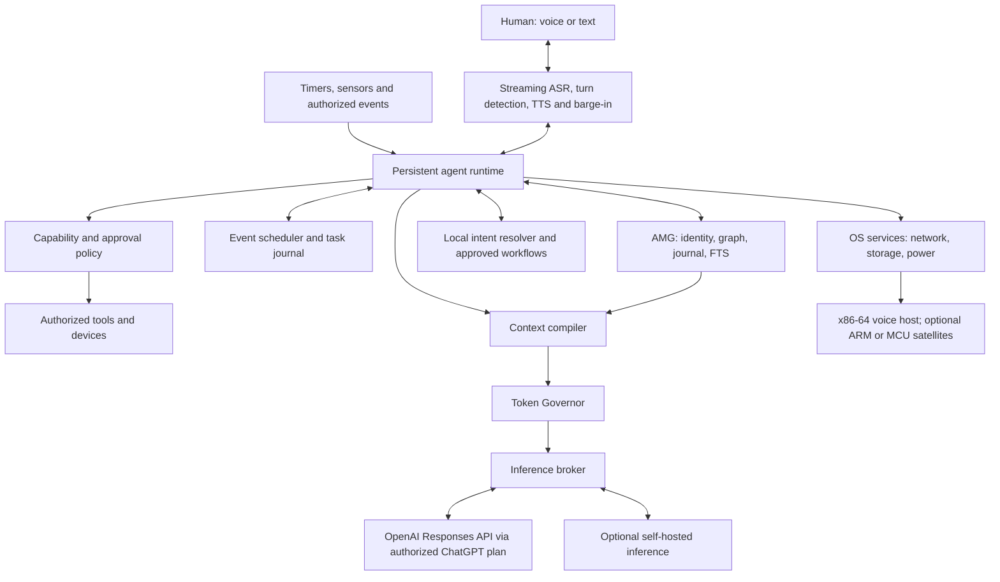

# AtomOS

**An OpenAI-native, always-on operating environment for personal AI agents, designed for natural voice conversation, zero incremental AI spending and efficient use of compute, power and tokens.**

AtomOS is an experimental project to build a persistent, conversational AI agent that can operate continuously on inexpensive, low-power hardware. The agent owns its identity, memory, permissions and scheduled activities independently of the language model it uses. Reasoning is delegated to OpenAI only when necessary, with the goal of operating within an owner's existing ChatGPT Plus subscription without additional AI spending. The runtime remains useful offline and retains a narrow inference interface for optional self-hosted models.

**Status:** M1.1–M1.4f local runtime and AMG foundations merged and offline/scale-tested. M2.1–M2.3d synthetic broker/authorization, bounded replay, official owner-run OAuth, encrypted vault, model discovery and token refresh verified at their respective gates. M2.4's three live qualification attempts are consumed with unknown usage; the final attempt received 8,465 bytes and validated eight SSE events before an unsupported event. M2.4b–c isolated offline auxiliary-event, opaque reasoning and refusal profiles merged and tested. General live inference, integrated account-bound admission, physical speech/power, private memory deployment and bootable OS remain unqualified. Next: M2.5 offline integration.

**Session handoff:** [PROJECT_STATE.md](PROJECT_STATE.md) records the current verified baseline, next steps and gates for ChatGPT and Codex.

**M2.5a candidate:** opt-in [atomic account-bound synthetic admission](docs/m2-atomic-admission.md), immutable request identity and one durable admission/reservation record. The M2.3 two-journal reference remains available; extended decoder integration is M2.5b. Offline validation is recorded in the handoff; no merge or live inference is authorized.

## Current implementation

| Slice | Implemented (automated tests passed) |
| --- | --- |
| M1.1 | Dependency-free Rust core/CLI, local/mock inference, turn epochs, bounded playback queue, fixed-budget persistent reservation ledger. [PR #2](https://github.com/idmfrank/atomos/pull/2) |
| M1.2 | Single-turn ALSA/Whisper.cpp/Piper smoke harness, transcript bounds, instance-scoped reservations, stub audio tests. [PR #3](https://github.com/idmfrank/atomos/pull/3) |
| M1.3 | Persistent Rust voice coordinator, streaming PCM protocol, RMS endpointing, follow-up window, AEC-gated cancellation, optional warm Sherpa-ONNX/Kokoro adapter, IPC startup/deadline fixes. [PR #4](https://github.com/idmfrank/atomos/pull/4) |
| M1.4a | Initial SQLite-backed typed memory, explicit owner CLI and regression tests merged; locked offline CI passed. See [AMG foundation](docs/m1-amg-foundation.md). |
| M1.4b | Opt-in read-only text and synthetic voice recall, persistent display name, bounded subject follow-up, live correction/deletion visibility. [PR #6](https://github.com/idmfrank/atomos/pull/6), [implementation](docs/m1-amg-conversation.md); locked offline CI passed. |
| M1.4c | Scoped graph/FTS retrieval, deterministic ranking, required facts, connector evidence and bounded data-only context previews. [Implementation](docs/m1-amg-context.md); locked offline CI passed. |
| M1.4d | Explicit expiring revision-specific voice grants, schema v2 migration, logical export/restore and integrity checks. [Implementation](docs/m1-amg-recovery.md); locked offline CI passed. |
| M1.4e | Active SQLite benchmark and alternative-engine qualification. [Implementation](docs/m1-amg-benchmark.md); scale CI passed after [PR #10](https://github.com/idmfrank/atomos/pull/10). |
| M1.4f | Compact-scope FTS optimization, reference verification, streaming logical backup and storage accounting. [Implementation](docs/m1-amg-optimization.md); CI and scale validation passed. |
| M2.1 | Offline inference broker, durable admission, typed synthetic response replay and usage reconciliation. [Implementation](docs/m2-inference-broker.md); locked offline CI passed. |
| M2.2 | Optional bounded Responses SSE/JSON decoder, strict text lifecycle, governor-gated byte replay and differential tests. [Implementation](docs/m2-responses-replay.md); CI and full scale validation passed. |
| M2.3 | Offline account-bound authorization policy, fixed-window request IDs, expiry, durable suspension and subscription error recovery. [Implementation](docs/m2-account-authorization.md); CI and full scale validation passed; live inference remains disabled. |
| M2.3b | Optional auth-only Sign in with ChatGPT utility, PKCE, signed identity and protected local session records. [Implementation](docs/m2-official-sign-in.md); CI passed; no inference. |
| M2.3c | Passphrase-encrypted credential vault, strict JSON, read-only model discovery, spending gate review and Node24 checkout pin. [Implementation](docs/m2-auth-hardening.md); CI passed; no inference. |
| M2.3d | Owner WSL OAuth registration, encrypted session reopen and account-specific catalog succeeded; [PR #17](https://github.com/idmfrank/atomos/pull/17), [PR #18](https://github.com/idmfrank/atomos/pull/18). 50% app cap observed; live refresh verified, revocation untested. |
| M2.4 | [Historical owner-run qualification](docs/m2-first-live-qualification.md), three consumed attempts; final bounded body received, no completed inference or actual usage validated. No fourth attempt. |
| M2.4b–c | [Offline protocol compatibility](docs/m2-protocol-compatibility.md): auxiliary events, optional opaque reasoning and typed refusal; PR #27–28 passed. Existing broker and live harness unchanged. |

Latest verified main baseline: [5f564ad](https://github.com/idmfrank/atomos/commit/5f564ad5641ea716d86efc894b2b132aaae9fa77), PR #29 documentation reconciliation over PR #28's runtime. [Post-merge CI 45919844209](https://github.com/idmfrank/atomos/actions/runs/45919844209), [full scale 45919947851](https://github.com/idmfrank/atomos/actions/runs/45919947851): 96 distinct Rust, 11 Python and 43 Node tests passed (150 total). No real inference in CI. Rust/Cargo 1.100.0; locked dependencies provisioned before offline build/test. M2.5a candidate evidence is separate in [the milestone document](docs/m2-atomic-admission.md).

### Benchmark results

**Release CLI history — text-only, no active store or ledger**

| Milestone | Executable (bytes) | Peak RSS (KiB) | Rust tests | Python tests |
| --- | ---: | ---: | ---: | ---: |
| M1.1 | 296,824 | 2,068 | 15 | 0 |
| M1.2 | 302,072 | 2,020 | 18 | 0 |
| M1.3 | 314,224 | 2,136 | 29 | 5 |
| M1.4a | 314,224 | 2,040 | 35 | 5 |
| M1.4b | 366,440 | 2,644 | 35 | 9 |
| M1.4c | 462,552 | 2,628 | 40 | 10 |
| M1.4d | 464,912 | 2,608 | 44 | 11 |
| M1.4e (schema v3) | 464,912 | 2,776 | 46 | 11 |
| M1.4f | 466,464 | 2,796 | 51 | 11 |
| M2.1 | 466,464 | 2,704 | 61 | 11 |
| M2.2 | 466,464 | 2,676 | 75 | 11 |
| M2.3a | 466,512 | 2,624 | 86 | 11 |
| M2.3b | 466,512 | 2,664 | 86 | 11 |
| M2.3c | 466,512 | 2,524 | 86 | 11 |
| M2.4 (PR #19, historical) | 466,512 | 2,588 (full-scale no-store baseline) | 86 | 11 |
| M2.4c (PR #28) | 466,512 | 2,576 (full-scale no-store baseline) | 96 | 11 |
| PR #29 (documentation reconciliation) | 466,512 | 2,588 (full-scale no-store baseline) | 96 | 11 |

Each release CLI benchmark executes 1,000 local text interactions. Rust/Python test counts refer to the workspace suite, not benchmark samples. PR #28 passed 43 Node tests (150 distinct total); owner last reported 43/43 local Node tests at PR #25. Peak RSS is measured process memory; runner variation can affect comparisons. M2.1's broker is a separate synthetic replay example, not linked into the measured conversational CLI. Excludes OS, speech engines, Python adapter, active AMG, ledger and administration executable. See [resource budget and run links](docs/resource-budget.md).

**Active AMG scale — verified PR #29 [combined benchmark](https://github.com/idmfrank/atomos/actions/runs/45919947851)**

| Metric | 1K entities | 10K entities | 100K entities |
| --- | ---: | ---: | ---: |
| Active assertions | 2,500 | 25,000 | 250,000 |
| Main DB / restore bytes | 1,216,512 | 11,186,176 | 116,084,736 |
| Active CLI peak RSS (KiB) | 4,304 | 4,132 | 4,196 |
| Exact recall p95 (ms) | 0.0261 | 0.0320 | 0.0474 |
| Graph traversal p95 (ms) | 0.0812 | 0.0828 | 0.0919 |
| Selective context p95 (ms) | 0.1382 | 0.1677 | 0.2051 |
| Common-term context p95 (ms) | 0.2141 | 0.3829 | 1.6446 |
| Reference common-term p95 (ms) | 0.3023 | 3.1094 | 24.9433 |
| Remember p95 (ms) | 1.1667 | 1.0571 | 1.1274 |
| Correct p95 (ms) | 1.2695 | 1.1047 | 1.1296 |
| Forget p95 (ms) | 1.1991 | 1.0683 | 1.0602 |
| Fixture precision / recall | 100% / 100% | 100% / 100% | 100% / 100% |
| Retrieval parity mismatches | 0 / 30 | 0 / 30 | 0 / 30 |
| Restore (seconds) | 0.0791 | 0.9551 | 9.8047 |
| Recovery peak RSS (KiB) | 7,388 | 9,216 | 9,108 |

Same-run no-store RSS 2,588 KiB; 100K incremental 1,608 KiB. All recovery checks passed. Hosted-runner variation is not a controlled hardware comparison; synthetic graph only, no physical voice, energy, hard aggregate quota or measured token savings. Historical PR #28/export measurements remain in [resource budget](docs/resource-budget.md), [handoff](PROJECT_STATE.md) and [M1.4f](docs/m1-amg-optimization.md).

**Responses decoder — verified PR #29 [post-merge CI](https://github.com/idmfrank/atomos/actions/runs/45919844209)**

| Profile | Fixture bytes | p95 1-byte (µs) | p95 64-byte (µs) | p95 4 KiB (µs) |
| --- | ---: | ---: | ---: | ---: |
| Strict reference | 2,497 | 43.7 | 26.5 | 26.0 |
| Compatibility, same wire | 2,497 | 37.1 | 26.5 | 26.2 |
| Auxiliary events | 2,930 | 47.0 | 31.0 | 31.0 |
| Extended, same wire | 2,497 | 38.3 | 26.2 | 26.1 |
| Opaque reasoning | 3,080 | 51.8 | 32.2 | 31.7 |
| Refusal | 2,394 | 58.6 | 31.2 | 24.2 |

1,000 samples per profile/read size; 18,000 synthetic replays, zero errors and provider calls. Combined decoder benchmark peak RSS 2,116 KiB; excludes network, broker fsync and speech. Default conversational CLI does not link the decoder/broker. Expanded fixtures are not equivalent inputs; compare same-wire rows for overhead, not a controlled latency claim.

### Development quick start

Linux, Rust/Cargo (declared minimum 1.75, CI previously verified on 1.100), Bash, Python 3, GNU coreutils, pkg-config and SQLite development library with FTS5. M1.4a requires explicitly provisioned, locked Cargo dependencies. Rust 1.75 compatibility of the new transitive dependency set has not been verified; CI uses the installed newer toolchain:

```bash
cargo fetch --locked # explicit provisioning step
bash scripts/test.sh
cargo run --locked --offline -p atomos-cli --bin atomos
bash scripts/benchmark.sh
```

Try "what is your name?" (local), "explain entropy" (mock), and "/quit". See [local voice smoke test](docs/local-voice-spike.md) and [persistent conversation](docs/persistent-conversation.md) for optional hardware adapters. Passing stub tests do not validate physical audio. Executable changes require passing CI before merge.

## Design goals

- Make natural, responsive, interruptible voice conversation the primary interface; retain text for accessibility and debugging. No screen or desktop is required.
- In order of priority: conversational quality, zero incremental AI spending, persistent identity and autonomy, token efficiency, power efficiency, then hardware cost. Security and privacy are non-negotiable constraints.
- Run continuously on efficient x86-64 hardware initially; support ARM, RISC-V and microcontroller-class satellites later.
- Minimize idle power, RAM, storage, CPU wakeups and network traffic without compromising conversational quality.
- Preserve identity, conversation context, commitments and preferences across reboots and model changes.
- Make OpenAI the first-class remote inference provider, using official ChatGPT plan sharing where eligible and authorized. Keep agent state and local operation independent of the provider.
- Treat inference as a finite system resource: resolve routine events locally, compile minimal context and enforce token budgets before every remote request.
- Target zero incremental AI spending; never purchase credits or silently switch to a separately billed API.
- Keep routine scheduling, simple commands and local memory available without internet access.
- Enforce least privilege for tools, data and device access. Keep the owner in control of the agent and its data.
- Prefer simple, auditable components and reproducible, hardware-specific builds.

## Non-goals for the first release

- Training or hosting a general-purpose LLM on a microcontroller.
- Replacing Linux with a new kernel before the agent runtime is validated.
- Supporting arbitrary desktop applications, POSIX compatibility on microcontrollers or a graphical desktop.
- Unrestricted autonomous actions, continuous audio recording or mandatory remote storage.
- Unlimited remote inference, unofficial ChatGPT endpoints, browser automation for inference, or circumventing subscription limits.

## Architecture



The diagram represents the target architecture, not all implemented services. The language model is a replaceable computational resource. The persistent agent runtime is responsible for state, context selection, task execution and authorization. Model output is treated as untrusted input, never as direct authority to execute a tool.

### Runtime lifecycle

| State | Activity |
| --- | --- |
| Resting | Wait for a wake word, timer, message or sensor event. |
| Perceiving | Capture speech or text and classify the event. |
| Responding | Retrieve relevant context and perform local or delegated conversation. |
| Reasoning | Invoke an appropriate model only when necessary. |
| Consolidating | Checkpoint state, summarize selected interactions and maintain memory within quotas. |

Use an event-driven architecture with bounded queues, explicit timeouts, retry backoff and no mandatory continuous inference loop. Keep task checkpoints durable, and make retried operations idempotent wherever possible.

## OpenAI-native inference and token economics

### Subscription-only operating policy

Use the official [Sign in with ChatGPT developer documentation](https://developers.openai.com/siwc/token-sharing-open-source) for eligible locally hosted integrations. The first integration must verify AtomOS eligibility, supported capabilities and the user's consent before enabling live inference. A private development repository does not itself establish eligibility.

- Use the documented OAuth registration and authorization flow, PKCE, validated identity and granted `chatgpt.tokens.use.direct` permission. Persist the issued client registration and a stable, opaque host identifier; protect and revoke credentials according to the provider's guidance.
- Discover available models through supported endpoints. Use authorized streaming Responses API requests with `store: false` and `stream: true` as required; keep durable conversation state locally. Do not assume this setting guarantees zero provider retention.
- No API-key billing fallback, credit purchases, unofficial endpoints or automatic plan upgrades. The owner must disable additional credit use for the app in ChatGPT's controls; confirm this prerequisite and fail closed if subscription-only spending cannot be established. An internal token cap alone cannot enforce the provider's billing rules.
- Treat provider usage limits and eligibility as authoritative. On a subscription usage limit, pause remote inference and direct the owner to ChatGPT usage settings. Do not infer a reset time, rotate accounts or retry around the restriction. Use bounded backoff only for transient failures.
- Plus allowances are shared, variable and not a guaranteed monthly raw-token quota. Account-level usage outside AtomOS may reduce available capacity. The agent does not inherit access to existing ChatGPT conversations or memories.

Reference: [OpenAI recovery guidance](https://developers.openai.com/siwc/token-sharing-open-source/errors-and-recovery) and [ChatGPT plan sharing controls](https://help.openai.com/en/articles/20001542-using-your-chatgpt-plan-in-other-apps-and-sites).

### Token Governor

The Token Governor is a mandatory runtime service, not a model prompt. All remote inference, including tool follow-ups, retries, memory consolidation and background work, must pass through a single admission interface.

1. Attempt safe deterministic intent resolution, structured memory lookup and authorized workflow execution locally.
2. Assign a priority and the lowest sufficient model/reasoning effort without an extra model call.
3. Compile only relevant instructions, recent context, selected memories and necessary tool schemas. Preserve authorization and safety-critical context; expand context when accuracy requires it.
4. Estimate and reserve input and maximum output usage before dispatch. Enforce rolling and monthly local quotas, concurrency limits and per-task call/deadline limits.
5. Stream the response, reconcile reported usage with the reservation and persist a durable ledger. Count reasoning tokens as part of output where reported, not twice. Track cached tokens separately; do not assume subscription discounts.
6. Preserve interactive capacity by deferring low-priority work. Stop remote calls when budgets, provider limits or authorization prohibit them. Continue local operations and explain degraded capabilities.

Use compact typed memory, local indexing, bounded context windows, stable prompt prefixes where beneficial, and validated reusable workflows. No mandatory remote embeddings, vector database, local LLM or idle inference. Never truncate essential context merely to meet a token target; request permission for a larger task or defer it. Cache only appropriate responses with scope, freshness and invalidation controls.

| Intelligence level | Execution |
| --- | --- |
| L0 — Reflex | Local timers, sensors, simple commands and facts; zero remote tokens. |
| L1 — Procedure | Local, previously authorized workflows; zero remote tokens. |
| L2 — Conversation | Efficient available OpenAI model, minimal sufficient context and reasoning. |
| L3 — Analysis | Increased context or reasoning within the task budget. |
| L4 — Deep reasoning | Explicitly prioritized complex tasks, bounded by available allowance and policy. |

### Initial inference budgets

| Metric | Engineering target / policy |
| --- | --- |
| Incremental AI spending | $0 above existing subscription; hard policy subject to verified provider controls. |
| Idle remote inference | 0 calls and tokens. |
| Routine events handled locally | At least 75% on a defined representative workload; unrestricted conversation measured separately. |
| Routine remote request | At most 1,500 raw input + output tokens, including reasoning. |
| AtomOS monthly raw-token target | 750,000, configurable downward as needed. |
| Default input / output budget | 1,024 / 256 tokens; output includes reasoning where applicable. |
| Background allocation | At most 10% of local monthly budget. |
| Interactive reserve | 30% of local monthly budget protected from noninteractive work. |
| Mandatory remote embeddings / local LLM | None. |

These are internal design targets, not ChatGPT Plus entitlements. For example, 100 events/day with 75% resolved locally and 900 total tokens per remote call yields 675,000 raw tokens over 30 days, before any additional calls. Measure actual usage and quality with a representative workload including tool loops and memory maintenance. Do not claim a month fits Plus until tested against real account limits.

### Voice pipeline

Implemented: 20 ms/16 kHz mono PCM, explicit activation, 60 ms onset, up to 100 ms pre-roll, 300 ms quiet endpoint and eight-second follow-up. Default half-duplex; barge-in only when AEC explicitly verified. Optional Sherpa-ONNX/Kokoro warm development adapter (Python); whole-utterance synthesis, not incremental. Whisper.cpp/Piper remains the batch baseline. Wake word, neural VAD, actual acoustic AEC and physical latency/quality validation remain outstanding. See [M1.3](docs/persistent-conversation.md), [M1.4a](docs/m1-amg-foundation.md), [M1.4b](docs/m1-amg-conversation.md). The following describes the target pipeline.

Keep wake-word detection and voice activity detection local. Use a bounded volatile pre-roll buffer, stream ASR during active speech, commit text only at a valid turn boundary, route through local intent resolution and the Token Governor, and synthesize streamed text in speakable chunks. Continue listening during playback with acoustic echo cancellation and cancel playback promptly on barge-in. Do not persist audio by default. No continuous cloud audio stream. Do not assume standalone OpenAI audio or Realtime endpoints are covered by plan sharing; disable them under subscription-only policy unless eligibility and zero incremental cost are verified. Voice quality and latency must be measured from the first prototype, including in-room acoustics and interruptions. See [voice architecture](docs/architecture.md) and [resource budget](docs/resource-budget.md).

## AtomOS Memory Graph (AMG) and identity

**Decision for M2:** temporal property graph with provenance, backed by SQLite + FTS5 on Linux. Logical model independent of physical storage through typed Rust interfaces. Indexed relationships and durable revision history; no separate database daemon, mandatory vector database or remote embeddings. Retain SQLite based on measured workload requirements; equivalent redb and CozoDB adapters are deferred, not benchmarked. See [AMG architecture](docs/amg-architecture.md).

| Memory class | Purpose |
| --- | --- |
| Identity | Stable agent ID, owner configuration, personality and instructions. |
| Working | Current conversation and active task context. |
| Episodic | Selected interactions, events and their provenance. |
| Semantic | User-approved facts, relationships and preferences. |
| Procedural | Tool descriptions, approved procedures and workflows. |
| Prospective | Reminders, commitments and scheduled tasks. |

Use typed entities, directed edges and assertions with source, trust, valid and recorded times. Exact lookup first, bounded traversal, FTS5, local ranking; optional local embeddings only after measured benefit. Compile minimal sufficient context including conflicts, provenance and policy before governor admission. Working context stays in bounded RAM. Support explicit memory operations, scoped retrieval, correction/supersession, export and deletion including derived indexes/caches. No raw audio, ASR partials or credentials in memory. Evaluate compact flash journal/CBOR on constrained targets.

Initial unmeasured targets: <8 MiB incremental memory overhead, 256 MiB aggregate data quota, warm p95 exact lookup <5 ms, traversal <20 ms, context compilation <50 ms, depth 2 default/3 maximum, zero remote retrieval tokens. Existing governor journal remains independent. SQLite is not itself encryption; owner access, encrypted storage/key recovery, retention and backup/deletion policies must be addressed before real private data.

M1.4a implements a stable local agent ID, owner scope and display name; M1.4b retrieves the name during conversation. Persistent identity is not authentication. Personality configuration, cryptographic credentials and device enrollment remain planned. Device enrollment, key rotation, recovery and revocation must be designed before cross-device identity synchronization is enabled. Private keys must never be sent to an inference provider.

### Current conversational memory behavior

Opt in with `atomos --memory DIR OWNER` (also before `--single-turn` or `--voice-events`). The existing database must be initialized by `atomos-memory`. The runtime uses a read-only SQLite connection and typed MemoryReader. Supported English grammar includes "what is your name?", "what is my favorite color?", "recall project status", and "and count" (previous subject). Exact values are re-read on each turn; only the subject key is retained in RAM. Clear it on unrelated or failed requests, mute, interruption, idle and restart. Missing facts or storage errors produce local status. Other open-ended questions still use mock reasoning. No model calls, automatic learning or voice mutations.

Synthetic data only: voice recall is explicitly opt-in and restricted to owner favorite_color, favorite_food and favorite_music text values plus agent display name. Voice is not authentication; the allowlist is not a privacy classifier. Text administration assumes a trusted OS operator. See [M1.4b](docs/m1-amg-conversation.md) for commands and tests. M1.4c adds explicit text-only scoped previews (`context SUBJECT QUESTION`), deterministic graph/FTS ranking and a conservative byte-bounded data packet. No automatic model routing. Scoped context compilation and active-store benchmarks are implemented; full policy-aware provider integration and authenticated private-memory controls remain pending; see [M1.4c](docs/m1-amg-context.md).

## Technical approach

| Component | Initial choice |
| --- | --- |
| Agent runtime | Rust, with a small dependency footprint |
| OS foundation | Headless Linux for development and audio validation; Buildroot x86-64 image after the pipeline is proven |
| Event processing | Bounded asynchronous Rust tasks |
| Persistent state | AMG temporal property graph, SQLite + FTS5 for M2; compact journal on constrained targets planned |
| Serialization | CBOR internally where useful; JSON for provider APIs |
| Networking | HTTPS/TLS, streaming WebSocket where supported |
| Voice | Rust coordinator; optional Sherpa-ONNX/Kokoro warm adapter, Whisper.cpp/Piper batch baseline; wake word, neural VAD, AEC and physical validation pending |
| Inference | OpenAI-first streaming Responses API adapter using eligible ChatGPT plan sharing; local rules and mock adapter as offline baseline |
| Inference policy | Local resolver, bounded AMG context compiler and offline broker with durable admission implemented; calendar/rolling budgets and authenticated provider permits planned |
| Security | Capability-based tool authorization, Ed25519 device identity, vetted cryptography |
| Embedded evolution | Rust `no_std` where practical; existing ESP-IDF/RTOS components when justified |

Use Linux first to avoid spending the initial development cycle on hardware drivers. Consider ESP32 firmware or a dedicated kernel only after profiling shows where the OS foundation creates a measurable bottleneck. Keep platform-specific code behind narrow interfaces; do not assume Linux binaries or libraries can simply be recompiled for a microcontroller.

## Reference hardware and resource budgets

Primary conversational reference: efficient x86-64 mini PC, Intel N100/N150-class minimum or equivalent; prefer a refurbished Core i5/Ryzen 5 with 16 GB RAM and 256 GB SSD if it meets the latency and power gates. A USB far-field microphone array with echo cancellation (e.g. ReSpeaker XVF3800) and a compatible speaker form the reference audio path. Exact SKU and audio routing remain subject to measured tests.

| Metric | Conversational host | Lightweight core / satellite |
| --- | --- | --- |
| Complete device cost | Target $300; indicative $230–$330 | Pi Zero 2 W core ~$35; MCU satellite TBD with audio |
| Average device input power | 6–12 W target | Core ~1.5 W; MCU target 0.1–0.5 W idle |
| Physical RAM | 16 GB preferred, 8 GB minimum candidate | Pi Zero 512 MB; ESP32-S3 PSRAM |
| OS + non-audio core RAM | 64 MB stretch target on specialized image | 64 MB core; 1–4 MB MCU target |
| Active voice stack and core RAM | Approximately 2.5 GiB planning budget | Voice inference offloaded to host |
| OS + non-audio runtime image | 128 MB stretch target, excludes model assets | 128 MB core; 4–16 MB MCU target |
| Local persistent agent memory | 256 MiB initial configurable aggregate quota | Hardware-dependent |
| Operation | 24/7 | 24/7 |
| General-purpose inference | OpenAI via eligible plan sharing; optional local model | Delegate to authorized host |

These are unvalidated engineering targets, not guarantees or price quotes. Host costs include audio and basic accessories; measure at the wall including audio equipment. Report OS, runtime, models and retained user data separately. Prioritize conversation quality over hardware price or an arbitrary footprint; report peak/idle RAM, whole-device energy, latency and quality together. Do not buy a dedicated GPU for the initial prototype.

### Voice quality gates

| Metric | Initial target |
| --- | --- |
| Wake detection | Under 200 ms after wake phrase ends |
| ASR | Faster than real time on reference hardware |
| End-of-turn detection | Under 400 ms for clear completed turns |
| Local spoken response | Under 500 ms after speech ends, simple intents |
| First audible OpenAI response | Under 1.5 s median after speech ends; report p95 |
| Barge-in to playback stop | Under 150 ms |
| Far-field operation | Evaluate 1, 3 and 5 m in quiet and noisy conditions |
| Continuity | Context survives sessions and restart |
| Idle remote inference | Zero |
 
Targets must be validated end to end; network latency is variable. A text-mediated voice pipeline may not match native speech-to-speech prosody or turn-taking. See [resource and benchmark plan](docs/resource-budget.md).

## Security and privacy

- Default-deny capabilities for filesystem, network, devices, tools and secrets.
- Require explicit confirmation for sensitive, irreversible or externally visible actions according to owner-configured policy.
- Treat model output, external content and tool results as untrusted; validate tool calls against typed schemas and authorization rules.
- Use secure transport, credential isolation, signed updates and encrypted storage where supported by the threat model and hardware.
- Support physical microphone mute where possible and clear indicators when capturing or transmitting audio.
- Maintain bounded audit logs of tool calls, policy decisions and task outcomes; redact credentials and sensitive payloads.
- Apply resource quotas, rate limits, cancellation, deadlines and recovery procedures to agent workloads. Prevent tools, extensions and background jobs from bypassing inference admission or accessing provider credentials.
- Provide a local owner-controlled shutdown and safe mode. Fail closed on authorization errors.

## Development roadmap

| Milestone | Deliverable / exit criteria |
| --- | --- |
| M0 — Design | README, architecture, threat model, resource and inference budgets, and reference hardware selection. |
| M1 — Voice-first agent core | Rust runtime, mock inference, identity and journal, local intent resolver and Token Governor. Parallel local voice spike: streaming ASR/TTS, VAD, barge-in and latency instrumentation. Validate official OpenAI eligibility before live calls. |
| M2 — Conversational integration | Integrate streaming OpenAI text responses with local voice pipeline, context compiler, model discovery and quota/error handling. Validate full-duplex interaction and no paid fallback. |
| M3 — Memory and scheduling | Bounded local retrieval, memory editing/export, durable reminders, approved workflow reuse, cancellation and restart recovery; budgeted consolidation. |
| M4 — Minimal OS | Bootable Buildroot x86-64 image for selected voice host, automatic startup, health checks and measured resource budgets. |
| M5 — Voice refinement | Improve acoustic robustness, prosody, turn-taking and far-field quality; tune power, latency and memory against measured baselines. |
| M6 — Tools and security | Typed tool calls, policy enforcement, approval flow, audit logging and adversarial tests before broad tool access. |
| M7 — Embedded port | Evaluate ESP32-S3 implementation, power management, storage durability and audio performance. |
| M8 — Distributed agent | Optional authorized node discovery, encrypted synchronization, conflict resolution and inference routing. Evaluate Nostr as an optional transport. |
| M9 — OS specialization | Compare optimized Linux, RTOS and custom kernel approaches using equivalent workloads. Proceed only with demonstrated benefits. |

M1 slices: M1.1 offline core, M1.2 audio smoke harness, M1.3 persistent voice coordinator, M1.4a durable AMG, M1.4b read-only recall, M1.4c scoped retrieval and M1.4d disclosure/recovery are merged and CI-tested. M1.4e: active SQLite scale benchmark passed; M1.4f: optimization and streaming recovery passed. Retain SQLite + FTS5 for M2; alternate adapters deferred, not measured. M2.1 offline broker merged and tested; M2.2 bounded Responses stream parsing and replay merged and tested; M2.3 synthetic account authorization and owner-run official OAuth/model discovery/refresh verified; M2.4b–c offline compatibility profiles verified. M2.4's live harness is closed without completed inference; M2.5 offline account-bound Governor integration is next. M1 exit still requires real model/device validation, measured acoustic interruption, activation evaluation and the remaining AMG acceptance gates. M2 requires official provider eligibility and spending controls. M3 expands memory management, scheduling and approved workflows rather than duplicating M1.4.

Security requirements apply from M1; M6 expands and verifies the tool execution surface rather than deferring basic security until then.

### First prototype acceptance criteria

1. Boot and start automatically on the reference board without a desktop environment.
2. Accept text input, resolve supported routine intents locally and stream an eligible OpenAI response through the Token Governor when inference is necessary; verify subscription-only controls before live use.
3. Preserve agent identity, conversation history and pending reminders after a controlled restart.
4. Continue local scheduling and safe commands when the inference provider is unreachable.
5. Recover from provider errors without an unbounded retry loop or duplicate side effects.
6. Measure image size, peak and idle RAM, CPU utilization, power, boot time and response latency. Document hardware and test conditions.
7. Verify zero remote inference while idle and no remote calls for deterministic test cases. Measure local resolution rate, total tokens per task, response quality and quota consumption on a reproducible workload.
8. Test budget exhaustion, concurrent reservations, restart recovery, denied scopes, unavailable allowance and provider quota limits. Demonstrate offline continuation, no paid fallback and no bypass of the Token Governor.

9. Demonstrate a complete microphone-to-speaker local conversation loop, barge-in, echo suppression and visible mute/listening states with deterministic mock inference; measure latency before enabling live OpenAI integration.

Voice is a first-milestone requirement. A CLI is a test interface, not the intended user experience.

## Repository layout and planned expansion

```text
atomos/
  README.md
  docs/             # Architecture, AMG, threat model, budgets, prototype notes
  crates/atomos-core/ # Rust domain, governor, audio, voice and tests
  crates/atomos-memory/ # AMG schema, typed storage, administration and read-only reader
  apps/atomos-cli/    # CLI and streaming voice protocol
  scripts/          # Offline tests, benchmarks, optional audio adapters
  .github/workflows/ # CI
  # Planned: memory/inference/policy crates, platform/ and expanded benchmarks/
```

Design: [architecture](docs/architecture.md), [AMG architecture](docs/amg-architecture.md), [threat model](docs/threat-model.md), [resource budget](docs/resource-budget.md), [inference architecture](docs/inference-architecture.md). Implementation: [M1.1](docs/m1-prototype.md), [M1.2](docs/local-voice-spike.md), [M1.3](docs/persistent-conversation.md).

## Prior art to evaluate

- [MimiClaw](https://github.com/memovai/mimiclaw): microcontroller agent runtime.
- [XiaoZhi](https://github.com/78/xiaozhi-esp32): ESP32 conversational voice endpoint.
- [ZeroClaw](https://github.com/zeroclaw-labs/zeroclaw): Rust agent runtime.
- [NullClaw](https://github.com/nullclaw/nullclaw): small Zig agent runtime.
- [Letta](https://github.com/letta-ai/letta): stateful agent and memory architecture.
- [AIOS](https://github.com/agiresearch/AIOS): OS-level abstractions for agents.
- [Tock](https://github.com/tock/tock): embedded kernel and isolation architecture.
- [Buildroot](https://buildroot.org/): minimal embedded Linux images.

These are research references, not selected dependencies. Verify current upstream status, licenses, security properties and performance claims before incorporating any code.

## Open decisions

- Exact x86-64 host, microphone/speaker configuration and audio engine selection after benchmarks.
- Owner sign-in and model catalog verified; validate actual model profiles, secure production enrollment, programmatic spending enforcement where available and provider retention policies. Headless enrollment remains a design gate.
- Establish real-world Plus usage headroom and benchmark token efficiency without compromising response quality.
- AMG schema/bindings, FTS5 and query benchmarks, embedded engine comparison, retention, flash wear and encryption/key recovery.
- Physical model compatibility, full-duplex AEC, wake word/neural VAD, incremental TTS and hardware latency/power.
- CI checkout action Node.js deprecation and minimum Rust version verification.
- Runtime dependency choices and whether shared core code can remain portable to MCU targets.
- Distributed identity protocol and synchronization semantics.
- Project license and eventual public release. Apache-2.0 is a candidate; no license is granted by this planning document.
- Project name availability before a public release.

## Project principles

Own the agent and its memory. Use OpenAI intelligence deliberately, spend tokens only when they improve the result, and never incur additional AI costs automatically. Spend energy on useful work, preserve state across failure, and measure before optimizing.

### M1.4d: memory recovery and disclosure

Schema v2 requires explicit migration of v1 stores; no auto-migration. Voice demo recall now requires an explicit expiring grant for the exact current revision, in addition to existing voice limits. New/corrected/restored facts default to no voice disclosure; no provider disclosure. Export/restore uses bounded logical records (not SQL), preserves identity and history, and rebuilds search in a new directory. Backups remain plaintext; older snapshots may resurrect forgotten records. Synthetic data only. See [M1.4d](docs/m1-amg-recovery.md) for commands, limits and outstanding controls.

### M1.4e active memory benchmark

After provisioning dependencies, run `AMG_SAMPLES=100 bash scripts/benchmark-amg.sh 1000`. Manual scale workflow supports 1k/10k/100k synthetic entities. Reports reader/graph/context/durable write latency, correctness, context bytes, quiescent storage and same-binary CLI RSS. Retain SQLite for M2 development; alternative adapters deferred pending owner review, no cross-engine performance claim. See [protocol](docs/m1-amg-benchmark.md).

### AMG schema v3 scale correction

The first 1k active-store benchmark passed, but exposed a global orphan-source cleanup scan (forget p95 151.786 ms). Schema v3 indexes source/successor references and deletes only affected unreferenced sources transactionally. v1/v2 stores require explicit `atomos-memory DIR OWNER migrate` with runtime stopped and offline backup; v2 grants preserved. Restore initializes v3 with no grants. Benchmark stages now report progress and time out individually. See [benchmark investigation](docs/m1-amg-benchmark.md#scale-deletion-correction-schema-v3). Schema v3 scale validation passed; see benchmark results above.

### M1.4f optimization and verification

[Combined scale results](https://github.com/idmfrank/atomos/actions/runs/45804554627): 100k entities, 250k assertions, main DB 116,084,736 bytes; active CLI RSS 4,228 KiB vs no-store 2,600 KiB; selective context p95 0.375 ms; common-term p95 44.899 ms. Synthetic fixture precision/recall 100%; 56.5% byte reduction vs same-scope facts, not measured token savings. M1.4f adds compact row-ID range optimization, synthetic reference parity, streaming export/restore (256 MiB/1M rows, outside active store), and `atomos-memory DIR OWNER storage` accounting; hard aggregate quota remains unverified. See [specification](docs/m1-amg-optimization.md) and [engineering rules](AGENTS.md). CI and scale validation passed.

### Verified M1.4f and M2.1

[Combined scale validation](https://github.com/idmfrank/atomos/actions/runs/45807347862): 100k entities, 250k assertions, common-term p95 5.9669 ms vs 60.7457 ms reference (same run), zero mismatches across 90 comparisons, active CLI 4,152 KiB RSS vs 2,568 KiB without store, 466,464-byte executable. Streaming export 600,005 records / 85,222,570 bytes, restore 18.20 s, recovery peak RSS 9,156 KiB; all integrity checks passed. Synthetic corpus only; no token savings or device certification. M2.1 merged and passed locked offline CI with a separate broker example and synthetic usage ledger; current conversation and AMG remain offline, no credentials or HTTP. See [M2.1](docs/m2-inference-broker.md).

### M2.2 offline Responses replay

After locked provisioning, `bash scripts/test-responses.sh` exercises the optional `responses-replay` feature (pinned serde/serde_json), compares wire and typed broker behavior and benchmarks the decoder. No default CLI networking or JSON dependency, credentials, real provider calls or private AMG disclosure. Narrow single-message text profile; unsupported event types fail closed. See [M2.2](docs/m2-responses-replay.md). Feature-enabled CI and full scale validation passed; see benchmark results above.

### M2.3 authorization and authentication

[Account authorization](docs/m2-account-authorization.md): fixed synthetic grant/window, durable single-use request IDs, expiry, account/host binding and persistent suspension. [Official sign-in](docs/m2-official-sign-in.md) and [auth hardening](docs/m2-auth-hardening.md) add optional Node cold-path OAuth, encrypted session vault, strict JSON, read-only catalog and explicit refresh. Actual owner-run sign-in, catalog and refresh succeeded. Programmatic spending verification, provider output ceiling, secure integrated credential handoff, revocation, trusted time and production admission remain open. No automatic renewal or paid fallback.

### M2.4 qualification and offline compatibility

[Historical owner-run procedure](docs/m2-first-live-qualification.md): all three one-shot attempts consumed, 3,072 retained local planning units; actual usage unknown. Final bounded stream received, eight events validated, then unsupported event. No successful terminal or expected output validated. No fourth attempt, no reset or re-registration. [Protocol compatibility](docs/m2-protocol-compatibility.md) records PR #27 and #28 verified isolated offline profiles; unknown events, tools and raw/streamed reasoning remain denied. SDK execution and live model profile remain unqualified.

## Documentation and contribution

[AGENTS.md](AGENTS.md) requires documentation review and updates with **every commit**, not just milestones. [PROJECT_STATE.md](PROJECT_STATE.md) is the canonical current handoff with test evidence, pending gates and next objective. Current architecture: [system](docs/architecture.md), [AMG](docs/amg-architecture.md), [inference](docs/inference-architecture.md), [threat model](docs/threat-model.md), [resource budget](docs/resource-budget.md). Earlier milestone files retain historical scope and measurements; use current guidance for operations. Review and reconcile verified CI/benchmarks after merge, never represent pending work as passed.
