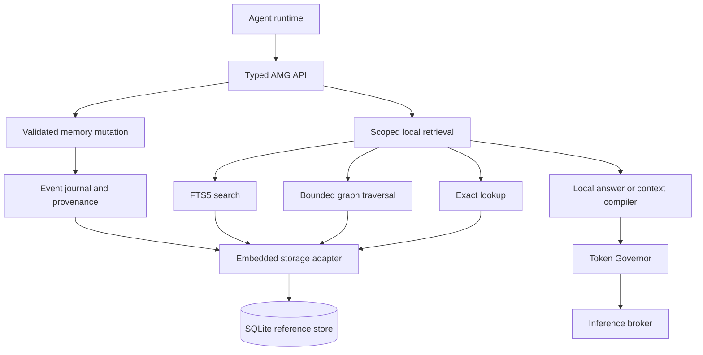

# AtomOS Memory Graph (AMG)

Status: accepted target architecture. M1.4a–f, schema v3 deletion, scoped context, grants, optimization and logical recovery merged and tested through 100K entities. Private deployment security and physical hardware validation pending. See [current state](../PROJECT_STATE.md).
See [system architecture](architecture.md), [inference architecture](inference-architecture.md), [resource budget](resource-budget.md), and [threat model](threat-model.md).

## CLI MVP boundary

The [CLI MVP roadmap](cli-mvp-roadmap.md) prioritizes persistent identity and explicitly committed owner facts, local recall, correction/forget and export on the existing Linux host. The conversational CLI currently has a read-only MemoryReader; explicit writes use `atomos-memory`. A coherent owner command surface is planned, not implemented by this roadmap. Keep values on stdin rather than shell arguments/history and avoid transcript logging.

A single authenticated SSH login establishes host access only. It does not qualify encrypted private storage, multi-user isolation or provider disclosure. Use synthetic facts until private deployment controls are reviewed. Full transcript persistence, automatic extraction/consolidation and reminders remain deferred. Working turns may be bounded volatile state. Preserve voice grants and existing tests as optional historical assets; they are not prerequisites for text interaction.

## Implemented baseline versus remaining design

- M1.4a: SQLite v1, local agent ID, entity keys, typed single-valued assertions/edges, source IDs, recorded-time correction history, FTS5, bounded graph traversal and data-only exact context formatting. Explicit local administration, no automatic learning. [Implementation](m1-amg-foundation.md).
- M1.4b: explicit read-only conversational reader, persistent display name, exact owner/entity recall, bounded subject follow-up, live correction/deletion visibility, startup scope/schema checks and restricted synthetic voice preferences. [Implementation](m1-amg-conversation.md). [Post-merge CI](https://github.com/idmfrank/atomos/actions/runs/45755478646) passed 35 Rust and 9 Python tests.
- M1.4c: bounded graph/FTS retrieval, deterministic ranking, required facts, connector/truncation flags and byte-bounded local context preview implemented. [Implementation](m1-amg-context.md). No live model calls or private context egress.
- M1.4d–f: expiring revision-specific demo voice grants, logical export/restore without grants, indexed deletion/schema v3, reference parity, streaming recovery and storage accounting implemented. SQLite retained; alternative engines deferred, not equivalently benchmarked. Authenticated private-memory access, encryption/key recovery, hard aggregate quota, complete memory classes and valid-world-time semantics remain unqualified or unimplemented. [Recovery](m1-amg-recovery.md) | [Optimization](m1-amg-optimization.md).

The schema and architecture below specify the target, not a claim that every control or memory class exists. Current reader exposes identity, exact recall, expiring revision-specific demo voice recall and scoped graph/FTS retrieval; administration owns mutation. Voice is not authentication. Synthetic fixtures only.

## Decision

AMG represents agent knowledge as a temporal property graph with a durable event journal, indexed local retrieval and bounded working memory. SQLite is the provisional reference storage engine on Linux, not a permanent mandate. The logical graph and typed Rust memory interfaces remain independent of storage. The agent owns its identity, facts, preferences and commitments across restarts and model changes.

SQLite offers embedded transactions, indexed adjacency lists, recursive CTEs, FTS5 and optional JSON. A separate graph database server is unnecessary at initial personal-agent scale. Embedded graph and key-value engines may outperform SQLite on specific workloads; compare equivalent semantics before final selection. No mandatory database service, vector database, remote embeddings or general-purpose local LLM.

| Candidate | Evaluation |
| --- | --- |
| SQLite + FTS5 | Reference: transactions, search, indexed traversal, recovery, bounded cache |
| Embedded graph engine | Native traversal versus footprint, query limits, licensing and deletion |
| Embedded key-value engine (e.g. redb) | Lookup versus application-maintained secondary indexes, traversal, search and atomic updates |
| Embedded document store | Optional comparison: schema flexibility versus relationship and indexing cost |
| Server-based graph/document DB | Deferred: extra runtime and operational overhead without demonstrated need |

Evaluate Rust bindings, system-linked versus bundled SQLite, FTS5 availability, license, maintenance, security, offline build and portability. No dependency or model installation is authorized by this design alone.

## Architecture



Runtime uses typed APIs, not model-authored SQL or unrestricted traversal. Local memory retrieval consumes zero remote tokens. Only the broker can transmit approved compiled context after governor admission. Storage never confers tool authorization. No idle inference.

| Memory class | Representation and lifecycle |
| --- | --- |
| Identity | Stable agent ID, owner scope, approved configuration/preferences; durable across restarts and models; secrets separate |
| Working | Bounded RAM turn/task state and references; evict at session/task boundary, persist only committed state |
| Episodic | Selected events and delivered conversation content, linked to provenance; retention-limited |
| Semantic | Typed entity properties and temporal directed relationships; confirm, correct, supersede, expire or delete |
| Procedural | Versioned validated workflow definitions (typed JSON/CBOR where useful); execution requires separate authorization |
| Prospective | Durable commitments/reminders with due time, state, deduplication and cancellation; scheduler owns execution |

Do not indiscriminately archive transcripts, raw audio or speculative ASR partials. M1.4 initially saves explicit owner-directed facts or synthetic fixtures. Later consented extraction may propose candidate facts; guesses cannot silently become facts or permissions.

## Logical schema

Use stable opaque identifiers (UUID or equivalent; format deferred), explicit owner scope, typed predicates and values, temporal validity and provenance. M1.4 is single-owner/single-host; scope must be present in keys and queries without implying certified multi-tenant isolation. Agent IDs are not proof of authentication. Device keys and OAuth credentials reside in separate protected storage.

| Record | Minimum fields and invariants |
| --- | --- |
| Agent identity | agent_id, owner_scope, display_name, config_version, created_at, updated_at |
| Entity | entity_id, owner_scope, kind, canonical_label, created_at, updated_at, status; separately indexed aliases |
| Assertion/property | assertion_id, owner_scope, subject_id, predicate, typed scalar or target entity, valid_from, valid_to, recorded_at, status, source_id, supersedes_id |
| Edge | Entity-valued assertion or equivalent separate edge table: source, predicate, target, bounded properties, validity, status, provenance; reverse index |
| Source/event | source_id, owner_scope, type, occurred_at, recorded_at, event/turn/task ID, trust and retention classes, optional bounded evidence |
| Episode | episode_id, owner_scope, turn/session ID, status, optional approved text, source references, delivered-prefix status |
| Workflow | workflow_id, version, approved definition reference, status; execution policy separate |
| Commitment | commitment_id, due_at_utc, original timezone where needed, status, idempotency key, source reference |
| Index | exact alias/entity/property, forward/reverse adjacency and scoped FTS entries; derived, rebuildable, deletable |
| Mutation metadata | schema version, operation ID, timestamp, mutation kind and record references; no retained deleted text |

Avoid two independently authoritative copies of relationship assertions. Define controlled predicate types, scalar units, null/missing semantics, foreign keys and uniqueness/check constraints. Reject invalid ranges, malformed inputs and cross-owner references. Resolve entity aliases within scope; identical names do not establish identity. Ask on ambiguity. Entity merge/split history is subject to deletion.

Valid time describes when a claim applies; recorded time describes when AtomOS learned it. Store UTC and original precision/timezone where relevant. Unknown validity remains unknown. Current/as-of queries distinguish active, superseded, disputed, expired and deleted assertions. Correction atomically supersedes prior evidence and creates a replacement; do not silently overwrite historical claims. Incompatible claims may coexist as disputed; newer is not automatically truer.

### Provenance and trust

Separate authenticated owner-confirmed, owner-stated but unverified, observed local event, external content and model-inferred candidate. Confirmation, provenance, confidence, sensitivity and freshness are distinct. Model confidence never grants authority. Store minimal evidence; deleting a source invalidates dependent claims unless independently re-confirmed without deleted content. Retrieved text is untrusted data, not system instructions. Model proposals cannot change identity, permissions, credentials or approved workflows. Voice alone does not authenticate sensitive mutations.

Example (logical, not SQL):

```text
owner --develops--> AtomOS
AtomOS --current_milestone--> M1.4
AtomOS --implemented_in--> Rust
M1.3 --validation_result--> passed
M1.3 --evidence--> CI run 45752758740
```

A project status query should retrieve milestone and evidence without reading unrelated history.

## Storage and concurrency

Version the schema. Use one serialized write path, short transactions, foreign keys on every connection, parameterized SQL, validated migrations, application-controlled query templates and atomic data/index updates. Evaluate WAL versus rollback journal under realistic write/recovery/disk constraints. Choose durability settings using crash tests. Never hold a transaction across ASR, TTS, inference or external actions. Do not run DB work on audio callback threads. Bound queues and deadlines; pause consolidation under contention.

Require FTS5 for reference search; verify availability at startup. Evaluate tokenizer, normalization and language behavior with fixtures. Escape/tokenize search inputs instead of accepting raw FTS syntax. Limit traversal depth, fan-out, visited IDs, result count, payload and execution time. A recursive CTE result LIMIT alone does not bound work; use indexed frontier expansion/cycle detection and cancellation, or deterministic iterative traversal.

Proposed defaults: depth 2, max 3; 32 neighbors per expansion, 256 visited nodes, 50 candidates, 16 KiB pre-compilation payload. These are local work caps, not provider token limits. Return ambiguity/truncation metadata rather than concealing omissions. Expand under explicit policy or request clarification if necessary.

Bound page/cache budgets and total retained data including indexes, journal/WAL and temporary storage; reserve headroom for checkpoints, migrations and writes. On disk-full or corruption, reject new writes or enter safe mode without resetting memories. Preserve essential identity/commitments. Test transactional migrations, interrupted writes, duplicate operations, backup and restore. Export a versioned logical format independent of physical storage. Engine replacement requires benchmark evidence, migration parity and rollback plan.

Existing fixed-budget Token Governor journal remains independent; do not migrate it until accounting, recovery and reconciliation invariants can be preserved. Memory outage must not permit unaccounted inference.

## Retrieval and context compiler

1. Parse safe deterministic local intent and exact entity/alias/property references without a routing model call.
2. Authorize owner scope, memory class and sensitivity.
3. Retrieve exact active assertions and bounded graph neighbors with relevant provenance, validity and conflicts.
4. Use scoped FTS5 if insufficient; rank locally on relevance, freshness, trust and task importance with deterministic tie-breaking. Frequency is not truth.
5. Optionally benchmark local embeddings for hard paraphrases. Add only if recall/quality benefit justifies resource and indexing cost; no remote embeddings.
6. Answer locally when data supports it. Otherwise compile compact typed context with applicable instructions, policy, recent turn/task state, selected facts, source IDs, uncertainty/conflicts and necessary tool schemas.
7. Estimate total request tokens including instructions, schemas and output reserve; reserve through governor before broker dispatch. Never omit essential context just to satisfy a token target. Ask, defer or authorize a larger bounded request.

Return selected facts, references, uncertainty, truncation and retrieval statistics. Separate runtime instructions from untrusted retrieved text. Only relevant authorized context leaves device. Cache by owner scope, policy version, memory revision and freshness; invalidate on mutation/deletion. Model-assisted extraction/consolidation is separately admitted and metered; test net token benefit.

## Privacy, retention and recovery

- Authenticated owner-controlled inspection, correction, export and deletion; minimal configurable retention. No raw audio, ASR partials, secrets or unrelated tool payloads in memory. Do not automatically retain full transcripts.
- Delete affected records, excerpts, FTS entries, derived facts/summaries/caches/embeddings and queued references, or re-confirm independent facts. Invalidate compiled contexts and cancel pending sends where feasible; already transmitted context cannot be recalled.
- Distinguish logical deletion from physical erasure. SQLite freelist, WAL, journals, backups, temporary files and SSD wear leveling may retain bytes. Evaluate secure-delete/checkpoint/compaction, FTS-specific behavior, encryption and backup expiry; no forensic erasure promise. Restore policy must prevent unnoticed resurrection of deleted records. Deletion metadata excludes deleted content.
- Restrict files/directories to service/owner; evaluate vetted encryption and key recovery. SQLite is not encrypted by default. No custom cryptography. Protect logs, backups and crash dumps. Default-deny sharing; no network listener or synchronization in M1.4.
- Synthetic data only in CI. Test memory poisoning, unauthorized access, stale/conflicting facts, deletion of derived data, interrupted and malformed input. Fail closed on authorization/corruption. Local safe mode remains useful.

## Performance and comparison

Targets are unmeasured. Compare on the same reference Linux host with equivalent semantics, fixtures, indexes, durability, cold/warm conditions. Report p50/p95/p99, failure counts, engine/build versions, corpus size, RSS/PSS, storage including sidecars, write amplification, startup/recovery and energy where measurable.

| Metric | Initial target |
| --- | --- |
| Incremental memory engine RAM | Under 8 MiB against same runtime without AMG; report cache settings |
| Aggregate persistent agent data | 256 MiB configurable quota |
| Exact indexed fact lookup | Warm p95 under 5 ms |
| Bounded graph traversal | Warm p95 under 20 ms |
| Context compilation including retrieval | Warm p95 under 50 ms |
| Traversal depth | Default 2, max 3 |
| Local retrieval / idle remote inference | Zero remote tokens |
| Separate database services | Zero required |

Synthetic datasets at 1k/10k/100k entities, sparse/high-degree edges, cycles, alias ambiguity, temporal/conflicting assertions and episodic text. Measure reads, writes, deletion, FTS recall, bounded expansion, cold restart, interruption, crash/disk-full recovery and quota pressure. Compare SQLite with at least one embedded KV and one embedded graph engine where available; report missing equivalent capabilities instead of comparing bare lookup timings. Include dependency/license/portability and maintenance complexity.

Compare exact/graph/FTS compiled context with full-history and selected-excerpt baselines on identical tasks and model. Measure precision/recall, essential-context recall, task correctness, local resolution rate, raw tokens per successful task, latency and energy. Include extraction/consolidation and retries; separate open conversation from representative 100-event workload. Use mock or officially eligible capped inference only. A smaller prompt with worse results is not a win. No assumed Plus allowance or measured token savings.

## M1.4 implementation gates

- Typed Rust interface, schema version and reference SQLite adapter; document bindings, FTS5, migration and offline build.
- Durable ID/config, scoped entities/aliases, typed facts/edges, sources, explicit owner-directed memory operations and bounded retrieval. Working context stays in RAM; selected committed episodes only. Synthetic data until owner controls exist.
- Exact lookup, bounded traversal, FTS5, provenance-aware context compiler and deterministic local fact response; integrate local/mock CLI and voice controller without audio-thread blocking.
- Tests: restart, correction/as-of queries, conflict and alias ambiguity, scope, cycles/high-degree limits, deletion/index invalidation, export, migration, transaction rollback, crash/disk-full, quotas, zero remote inference and context completeness.
- Reproducible benchmarks and comparable alternative engine evaluation before permanent selection. Preserve offline CI with explicitly provisioned dependencies.
- Exit: restart restores identity/approved facts; local fact query uses zero inference; update/delete affects retrieval and indexes; context preserves necessary facts/provenance; corrupt/full storage cannot bypass policy. CI is necessary, not proof of acoustic, privacy or power targets.

M2 integrates authorized broker only after official plan eligibility and spending controls are verified. M3 expands memory management, durable scheduling, workflows and approved consolidation. Cross-device sync, local embeddings and encrypted key recovery are separately gated.

## Technical references

- [SQLite architecture](https://www.sqlite.org/arch.html)
- [Recursive CTEs](https://www.sqlite.org/lang_with.html)
- [FTS5](https://www.sqlite.org/fts5.html)
- [Atomic commit](https://www.sqlite.org/atomiccommit.html)
- [WAL](https://www.sqlite.org/wal.html)
- [Secure-delete caveats](https://www.sqlite.org/pragma.html#pragma_secure_delete)
- [redb candidate](https://github.com/cberner/redb)

References describe candidate capabilities, not benchmark results or approved dependencies.

## Measured engine decision

See [M1.4f baseline](m1-amg-optimization.md#reference-baseline-and-decision) for successful 1k/10k/100k results. Retain SQLite + FTS5 for M2 development, preserve logical interface and export, defer equivalent alternative adapters pending owner approval. No claim SQLite outperforms redb/CozoDB. CI fixture does not certify target hardware, full quota, privacy or complete memory classes. [Engineering verification rules](../AGENTS.md) require reference parity and independent tests for behavior-preserving optimization.
