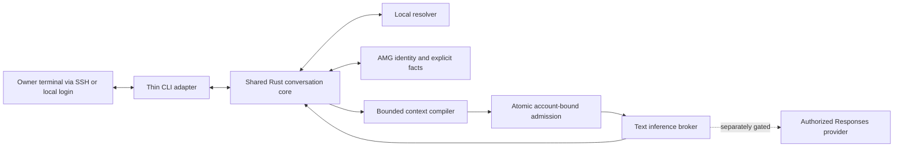
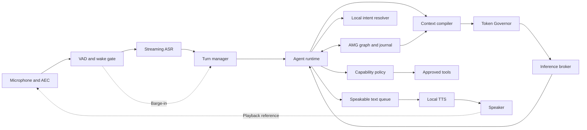

# AtomOS architecture

Status: CLI MVP target adopted 2026-11-27. The existing text runtime is local/mock; M2.5a admission and decoder profiles remain isolated synthetic components. PR #32 main `5bca8a15e8245e9631d8a978a988c01cdc812f7a` passed CI/full scale with unchanged PR #31 runtime behavior. Voice development and physical qualification are paused. [Roadmap](cli-mvp-roadmap.md) | [Current state](../PROJECT_STATE.md) | [README](../README.md) | [Threat model](threat-model.md) | [Resources](resource-budget.md) | [Inference](inference-architecture.md) | [AMG](amg-architecture.md)

## System boundary

One owner runs a foreground Rust CLI on an existing Linux host through a local terminal or existing SSH login. AtomOS adds no web server, SSH server or application authentication service. The owner controls identity, committed facts and permissions; the model supplies optional reasoning after separate provider gates. No general-purpose local LLM, microphone, speech models, new hardware or bootable image is required.

This is target integration, not current executable wiring. The conversational CLI uses mock reasoning for open questions, reads AMG through a typed read-only interface and leaves mutations to `atomos-memory`. Atomic admission and extended decoder outcomes still need offline integration before any production adapter. Model output is data, never authority for memory mutation, shell execution or tools.

## Runtime boundaries and proposed interfaces

| Component | CLI MVP responsibility | Boundary |
| --- | --- | --- |
| CLI adapter | Terminal input/output, command parsing, exit/status and cancellation signals | Thin adapter; one owner and active session; proposed command contract still to define |
| Conversation core | Turn/task ownership and bounded working context | Reject stale delivery; no full transcript persistence by default |
| Memory | Identity, explicit facts, correction/forget/export and local retrieval | Typed APIs; short transactions; separate current administration CLI |
| Local resolver | Deterministic supported commands and fact queries | No inference charge; expose unsupported/ambiguous states honestly |
| Context compiler | Bounded relevant context and trust/provenance labels | Private AMG provider disclosure stays separately gated |
| Admission and broker | Account/request identity, reservation, outcomes and settlement | One durable admission before response read; no detachable public permit |
| Provider adapter | Future authorized text transport with bounded lifetime | Separate security/spending/time/credential gate; no new live authorization |

Keep existing Rust crate/interface boundaries where useful; do not create new processes or rewrite the runtime for a CLI. Existing SSH authenticates host access, not provider disclosure or multi-user isolation. Optional existing `tmux` keeps a process running across disconnects but adds no AtomOS durable session recovery or automatic credential unlock.

## CLI conversation lifecycle

1. Wait for a submitted terminal line without idle remote calls.
2. Validate turn/task/input and resolve supported local commands or facts.
3. For unresolved conversation, build bounded in-session context; use mock/synthetic responses until an approved provider adapter exists.
4. Validate a fresh admission context, persist reservation and decode the selected text outcome. Preserve accounting and privacy policy regardless of delivery style.
5. Display only output permitted by the reviewed outcome contract. Current synthetic parsing buffers until terminal validation/settlement; incremental terminal streaming is not implemented by this roadmap.
6. On cancellation, EOF, disconnect or errors, stop stale delivery and expose local status. Define signal/exit behavior in the CLI contract. A disconnect/socket close does not prove upstream generation or usage stopped.
7. Persist explicit memory commits and accounting outcomes. Restart restores identity and committed facts, not necessarily volatile working turns. No automatic retry, transcript archive, reminders or background consolidation.

## Verified Linux deployment profile

The [owner-local CLI deployment](linux-cli-deployment.md) is verified at PR #34 main `5869e205167a3dde3a6a77392af294101e6a46c3`. One owner account holds clean source, tested versioned binaries and a private generic identity store; one local/mock foreground CLI runs in tmux. No service autostart, browser/audio stack, extra inference model or production provider path is introduced. Build/test tools are separate from running CLI dependencies.

All 173 host tests, 18,000 decoder samples and SSD-backed 1K/10K/100K memory recovery passed. At 100K, selective context p95 0.3974 ms and incremental CLI RSS 1,448 KiB meet existing targets. Keep the existing Rust/SQLite architecture and Linux foundation; no rewrite or enlarged resource allocation is justified. The ordinary CLI remains local/mock and read-only against AMG; explicit mutations use its separate administration binary. Private/provider gates remain unchanged.

## M2.5b contract boundary

The [offline text-outcome contract](m2-text-outcomes.md) specifies explicit extended atomic replay with Local/Completed/Refused/Failed final results. It reuses existing decoder profiles, immutable request identity, fresh context and v1 accounting records; preserves the strict reference; and adds outcome/cancellation/persistence-fault tests. Implementation is pending. No CLI command/session wiring, transport, incremental display or private memory access is added by the contract.

## State, persistence and concurrency

M2.5a [atomic admission](m2-atomic-admission.md) owns a private bounded ledger and one outstanding reservation. Unknown outcomes remain charged and block further synthetic admission; revocation/overrun suspension are durable. The implementation is not connected to conversational AMG, OAuth or a network. Real crash locks require manual investigation; clean reopen tests do not qualify automatic crash recovery.

One conversation owner manages current turn/task and bounded working context. Serialize memory writes through typed interfaces; never hold an AMG transaction across inference. SQLite + FTS5 and existing recovery formats remain the reference. Keep secrets out of memory and accounting journals. Terminal/session buffers and redirected output can retain text; do not add transcript/secret logging.

Scheduling, concurrent conversations, automatic startup and autonomous tools are deferred. A later browser or voice interface should reuse core APIs after its own scope/security review.

## Deferred voice architecture and historical assets

Preserve the existing coordinator, PCM buffers, adapters, fixtures and offline tests. The following earlier voice design is retained for a possible later interface. It is not a CLI MVP requirement or permission to resume hardware/model work; do not delete regression coverage because audio is paused.

The diagram is the target runtime, not the current executable wiring. The diagram is logical: the governor makes the final admission decision after context compilation and before any provider dispatch. Speech engines must not access OpenAI credentials. Only the broker may open inference connections.

### Deferred voice lifecycle

1. Idle: local wake detector only, bounded volatile pre-roll if enabled. No inference and no stored raw audio.
2. Listening: ASR consumes frames as the user speaks. Partial transcripts are provisional and do not trigger remote calls or irreversible actions.
3. Turn commit: endpointing finalizes a transcript; tag it with a unique turn ID and monotonic epoch. Resolve locally when safe, otherwise retrieve context and request an admission permit.
4. Responding: stream text; emit speakable clauses with bounded buffering. Avoid speaking incomplete markup, unverified tool results or stale text.
5. Barge-in: detect genuine near-end speech during playback; increment epoch, stop and flush audio immediately, cancel synthesis and provider request where possible. Discard stale events by epoch. Cancellation does not guarantee provider usage is refunded.
6. Complete: persist delivered response or spoken prefix separately from generated text, outcome and usage. Do not pretend interrupted output was delivered. Remain in a bounded follow-up window before returning to wake mode.
7. Fault: release resources safely, preserve durable state, give a local spoken status when possible; never silently switch to paid inference.

Use monotonic clocks for latency and timeouts and wall clock for durable reminders. No remote requests for speculative ASR partials. Each queue has a size limit and explicit overload policy; audio capture may drop old frames with a recorded discontinuity rather than accumulating unbounded latency. AEC needs the actual playback reference, synchronized with capture; validate USB routing before selecting a microphone/speaker.

### Deferred speech engine selection

Candidates: local wake word (openWakeWord), VAD (Silero or simpler baseline), streaming ASR (sherpa-onnx/Zipformer), accuracy baseline (whisper.cpp), TTS (Kokoro and Piper). These are candidates, not approved dependencies. Verify upstream licenses, model redistribution rights, target-language quality and runtime footprint. Wrap engines behind narrow Rust interfaces. Keep models warm only if latency/power tests justify it. Compare in-room audio and expressive quality, not only offline word error rate.

## Historical first vertical slice (M1)

The original voice-first vertical slice included mock responses, interruptible playback, event timestamps and physical microphone/speaker evaluation. These acoustic exit criteria are now deferred. CLI MVP acceptance is defined in [the roadmap](cli-mvp-roadmap.md); historical audio qualification remains incomplete.

## Preserved implementation evidence

[M1.4b post-merge CI](https://github.com/idmfrank/atomos/actions/runs/45755478646): 35 Rust + 9 Python tests, smoke checks and no-store text benchmark passed. The Rust core provides mock/local inference, turn epochs, bounded PCM, RMS endpointing and IPC. Optional warm Sherpa-ONNX/Kokoro adapter defaults to half-duplex; real speech engines and AEC remain unvalidated.

AMG v1 implements persistent local identity, scoped entities and typed assertions/edges, recorded-time revision history, transactional correction/deletion and FTS5. The explicit administration CLI owns mutation. M1.4b adds MemoryReader and a SQLite read-only connection to the text and voice host. Exact lookup only in conversation; follow-up retains a subject key, never a cached value. Final-turn validation precedes lookup; no database operation on microphone callback. Voice demo allowlist is not authentication. No implicit store creation/migration or remote inference. See [AMG foundation](m1-amg-foundation.md) and [conversational integration](m1-amg-conversation.md).

M1.4c–f subsequently implemented scoped graph/FTS context, revision-specific demo voice grants, schema v3 deletion and bounded streaming logical recovery; see [AMG optimization](m1-amg-optimization.md). Private authenticated memory, encrypted recovery and aggregate quota remain gates. M2.1–M2.4c add separate offline broker, authorization, decoder profiles and owner-run auth/qualification utilities; no integrated live broker or private AMG egress. Wake word, neural VAD, physical AEC/audio and scheduler remain deferred beyond the CLI MVP. The fixed-budget governor journal remains separate from AMG. See [AMG architecture](amg-architecture.md) for target requirements.

