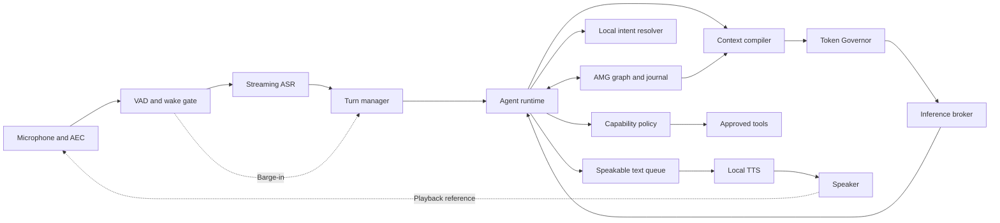

# AtomOS architecture

Status: target architecture; M1.1–M1.4b merged and automated validation passed. M1.4c retrieval/context compilation next. Conversation-first baseline. See [README](../README.md), [threat model](threat-model.md), [resource budget](resource-budget.md), [inference architecture](inference-architecture.md), [AMG architecture](amg-architecture.md).

## System boundary

A headless Linux x86-64 host runs an owner-controlled Rust agent and local speech engines. The agent is authoritative for identity, state, permissions and task execution. OpenAI supplies bounded reasoning on demand; it is not the owner of the agent or its memories. No general-purpose local LLM is required. Low-cost satellites are a later profile, not a dependency of the first prototype.

The diagram is logical: the governor makes the final admission decision after context compilation and before any provider dispatch. Speech engines must not access OpenAI credentials. Only the broker may open inference connections.

## Runtime boundaries and proposed interfaces

| Component | Responsibility | Interface sketch |
| --- | --- | --- |
| Audio | Capture, playback, AEC reference, mute | Frame stream, playback cancel, device status |
| ASR | Partial and final transcripts | Audio frame in, transcript events out |
| Turn manager | Wake, endpointing, interruption, session expiry | Turn ID, epoch, timestamp, event |
| Agent | Conversation orchestration and task lifecycle | Turn request, response stream, cancellation |
| Memory | Durable typed facts, conversation journal, search | Read bounded context, append events, export/delete |
| Local resolver | Safe high-confidence deterministic intents | Resolved / ambiguous / escalate |
| Context compiler | Smallest sufficient context, trust labels | Task plus retrieved data to request |
| Governor | Reserve, admit, reconcile, pause | Budget decision and single-use permit |
| Provider | Authorized streaming OpenAI text inference | Permit + request to deltas/usage/error |
| Policy | Default-deny tool authorization | Typed intent to deny/approve/allow |
| TTS | Natural speech from text chunks | Text stream to PCM, cancel by epoch |
| Scheduler | Durable timers and event-driven work | Due events, acknowledgement, cancellation |

Initial crates: atomos-core (domain types and turn state), atomos-audio (engine interfaces), atomos-memory, atomos-inference, atomos-policy, atomos-runtime. A thin host binary wires components. Names and boundaries may evolve after the spike; no unnecessary cross-process protocol before profiling. Isolate native speech engines in supervised workers if crash containment or measured constraints warrant it.

## Conversation lifecycle

1. Idle: local wake detector only, bounded volatile pre-roll if enabled. No inference and no stored raw audio.
2. Listening: ASR consumes frames as the user speaks. Partial transcripts are provisional and do not trigger remote calls or irreversible actions.
3. Turn commit: endpointing finalizes a transcript; tag it with a unique turn ID and monotonic epoch. Resolve locally when safe, otherwise retrieve context and request an admission permit.
4. Responding: stream text; emit speakable clauses with bounded buffering. Avoid speaking incomplete markup, unverified tool results or stale text.
5. Barge-in: detect genuine near-end speech during playback; increment epoch, stop and flush audio immediately, cancel synthesis and provider request where possible. Discard stale events by epoch. Cancellation does not guarantee provider usage is refunded.
6. Complete: persist delivered response or spoken prefix separately from generated text, outcome and usage. Do not pretend interrupted output was delivered. Remain in a bounded follow-up window before returning to wake mode.
7. Fault: release resources safely, preserve durable state, give a local spoken status when possible; never silently switch to paid inference.

Use monotonic clocks for latency and timeouts and wall clock for durable reminders. No remote requests for speculative ASR partials. Each queue has a size limit and explicit overload policy; audio capture may drop old frames with a recorded discontinuity rather than accumulating unbounded latency. AEC needs the actual playback reference, synchronized with capture; validate USB routing before selecting a microphone/speaker.

## Speech engine selection

Candidates: local wake word (openWakeWord), VAD (Silero or simpler baseline), streaming ASR (sherpa-onnx/Zipformer), accuracy baseline (whisper.cpp), TTS (Kokoro and Piper). These are candidates, not approved dependencies. Verify upstream licenses, model redistribution rights, target-language quality and runtime footprint. Wrap engines behind narrow Rust interfaces. Keep models warm only if latency/power tests justify it. Compare in-room audio and expressive quality, not only offline word error rate.

## State and concurrency

One turn manager owns active conversation state. Use bounded asynchronous channels and cancellation tokens; do not hold database transactions across inference. A single durable journal records committed state transitions. AMG models memory as a temporal property graph with provenance, event journal, exact/graph/FTS retrieval and bounded context compilation. SQLite is the provisional reference engine behind typed interfaces; benchmark embedded graph and KV alternatives. Use schema versioning, bounded retention, explicit migration/recovery. See [AMG architecture](amg-architecture.md). Preserve provenance, distinguish untrusted retrieved content from instructions, and enforce deletion in derived indexes. No plaintext credentials in journal.

The scheduler is event-driven. Background work competes for neither interactive audio nor reserved inference capacity. Prioritize audio callbacks, local interaction and active user requests over consolidation. Avoid real-time priority changes until tested against starvation.

## First vertical slice (M1)

Run on a normal headless Linux development host before building a minimal distribution. Deliver a local conversation loop with mock responses, an interruptible playback path and event timestamps. In parallel implement governor and local intent tests; no live OpenAI calls until authorization and cost controls are verified. Start with recorded/synthetic fixtures and then test physical microphone and speaker. M2 integrates streaming remote text only after both paths pass.

## Verified implementation boundary

[M1.4b post-merge CI](https://github.com/idmfrank/atomos/actions/runs/45755478646): 35 Rust + 9 Python tests, smoke checks and no-store text benchmark passed. The Rust core provides mock/local inference, turn epochs, bounded PCM, RMS endpointing and IPC. Optional warm Sherpa-ONNX/Kokoro adapter defaults to half-duplex; real speech engines and AEC remain unvalidated.

AMG v1 implements persistent local identity, scoped entities and typed assertions/edges, recorded-time revision history, transactional correction/deletion and FTS5. The explicit administration CLI owns mutation. M1.4b adds MemoryReader and a SQLite read-only connection to the text and voice host. Exact lookup only in conversation; follow-up retains a subject key, never a cached value. Final-turn validation precedes lookup; no database operation on microphone callback. Voice demo allowlist is not authentication. No implicit store creation/migration or remote inference. See [AMG foundation](m1-amg-foundation.md) and [conversational integration](m1-amg-conversation.md).

Wake word, neural VAD, physical AEC/audio, full context compiler, authenticated memory access, export/recovery, scheduler and live broker remain pending. The fixed-budget governor journal remains separate from AMG. See [AMG architecture](amg-architecture.md) for target requirements.
